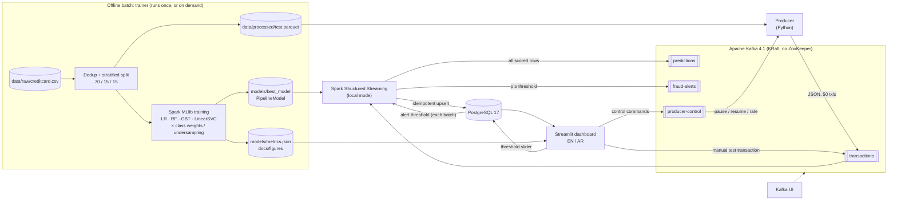

# PLAN — Real-Time Credit Card Fraud Detection

**Kafka · Spark Structured Streaming · Spark MLlib · PostgreSQL · Streamlit**

| | |
|---|---|
| Status | **Draft, awaiting approval** (end of Phase 1) |
| Date | 2026-11-14 |
| Target host | Windows 11 + Docker Desktop (WSL2). Whole stack ≤ ~6 GB RAM |
| Start command | `docker compose up` (trains the model automatically on first run) |

---

## 1. Goal

An end-to-end system that:

1. trains and compares fraud classifiers offline with Spark MLlib on the Kaggle *Credit Card Fraud Detection* dataset;
2. replays the **held-out test split** as a live stream of transactions through Apache Kafka;
3. scores every transaction in real time with Spark Structured Streaming and the saved model;
4. shows live KPIs, alerts, model performance and an interactive "Test a Transaction" tool in a bilingual (English/Arabic) Streamlit dashboard.

---

## 2. Decisions from the Phase 1 Q&A

| # | Topic | Decision |
|---|---|---|
| 1 | Environment | Windows 11 Pro, 32 GB RAM, Docker Desktop 28.5 (WSL2). Memory limits are set for an **8–16 GB laptop (~6 GB stack budget)**. **All tests run in Docker** (the host's Java 24 and Python 3.13 don't suit PySpark). **Git:** `git init`, one commit per phase, never pushed. |
| 2 | Dataset | Manual Kaggle download to `data/raw/creditcard.csv`, plus an optional `.
un.ps1 download-data` (Kaggle API in a container, used only if `kaggle.json` exists). **Exact duplicates are removed before splitting** (prevents train/test leakage). **Exact stratified 70/15/15 train/validation/test split** (seed 42). |
| 3 | Models and imbalance | **LR, RF, GBT, LinearSVC**, each trained with **class weights** and with **undersampling** (1 fraud : 10 legit, train split only). **Small grid** of 2 configs per model, so 16 fits. Features: V1–V28, `log1p(Amount)`, **hour-of-day** (as sin/cos) from `Time`; raw `Time` is dropped. |
| 4 | Metric and threshold | The best model is chosen by **validation AUC-PR**. The default alert threshold maximizes **F1 on validation**. The **test split is used once**, for final reporting. ROC-AUC, precision, recall, F1 and the confusion matrix are reported for every model. |
| 5 | Streaming | **50 tx/s** default, **loops forever**, **original `Time` order**. **Live producer control** from the dashboard (pause/resume/rate) via a `producer-control` topic. |
| 6 | Storage and infrastructure | **Kafka + PostgreSQL** (the dashboard reads Postgres). **Kafka UI** (`kafbat/kafka-ui`, the maintained fork of provectus). **Spark in local mode**, one container. |
| 7 | Dashboard | **Streamlit**, **EN/AR toggle** (all strings from one translation dictionary, RTL text in Arabic mode). **5 pages:** Live Monitor, Model Performance, Test a Transaction, System Health, Architecture/About. The **threshold slider drives Spark's alerting** live (shared setting in Postgres). |
| 8 | Test a Transaction | Sent **through Kafka** (`source = "manual"`); the page waits up to 15 s for its prediction in Postgres. |
| 9 | Documentation | Mermaid diagrams plus **exported SVG/PNG** (mermaid-cli in Docker). **Automated Playwright screenshots** (EN + AR). **Figures** (PR, ROC, confusion matrix, threshold sweep) and `docs/RESULTS.md` tables. |

---

## 3. Architecture



### 3.1 Life of one transaction

```mermaid
sequenceDiagram
    autonumber
    participant P as Producer
    participant T as Kafka · transactions
    participant S as Spark (foreachBatch)
    participant DB as PostgreSQL
    participant O as Kafka · predictions / fraud-alerts
    participant D as Dashboard
    P->>T: TransactionEvent (event_time = now, UTC)
    S->>T: read new offsets (trigger every 1 s)
    S->>DB: read current alert_threshold
    S->>S: parse JSON, PipelineModel.transform, fraud_probability
    S->>O: every row to predictions; p ≥ t to fraud-alerts
    S->>DB: INSERT … ON CONFLICT (transaction_id) DO NOTHING
    D->>DB: KPIs / feed / alerts (refresh every 2 s)
```

---

## 4. Components

### 4.1 Trainer (offline batch, Spark MLlib)

Entry point is `src/training/train_model.py`, run with `spark-submit` in the `trainer` service.

- **Modes:** under `docker compose up` it runs in *train-if-missing* mode: it exits immediately if `models/best_model/` and `models/metrics.json` already exist. `.\run.ps1 train` forces a retrain.
- **Load:** reads the CSV with an explicit schema. If the file is missing, it stops with a clear message that includes the Kaggle link and the expected path. It validates the column names and that `Class` is in {0, 1}.
- **Clean:** drops exact duplicate rows (about 1,081) **before** splitting, and logs the count.
- **Split:** **exact** stratified 70/15/15. *(Changed during Phase 2: per-class `randomSplit` gave 321/89/63 frauds instead of about 331/71/71.)* Within each class, rows are ranked by a seeded content hash `xxhash64(seed, row)` and cut at 70% and 85%. Every split therefore has the same fraud ratio, and the split is reproducible whatever order Spark reads the rows in. The splits are saved to `data/processed/{train,val,test}.parquet`, with test sorted by `Time` for replay.
- **Feature pipeline:** fitted on **train only** and stored inside the `PipelineModel`, so streaming applies exactly the same transforms (no train/serve skew):
  `SQLTransformer` (`log_amount = log1p(Amount)`, `hour_sin` / `hour_cos` from `(Time/3600) mod 24`) → `VectorAssembler(V1..V28, log_amount, hour_sin, hour_cos)` → `StandardScaler(withMean, withStd)` → classifier.
  The feature list is one constant (`FEATURE_COLUMNS` in `src/common/schemas.py`); **`Class` is never a feature**, and a unit test asserts this.
- **Imbalance strategies:**
  - *class weights*: `weightCol` = n / (2·n_class), computed on train;
  - *undersampling*: keep all train frauds plus a random sample of legit rows at 1:10.
- **Grid** (each config scored on validation AUC-PR):

  | Model | Configs |
  |---|---|
  | LogisticRegression | `regParam` ∈ {0.001, 0.01}, `maxIter` 100 |
  | RandomForestClassifier | `numTrees` 100, `maxDepth` ∈ {8, 12} |
  | GBTClassifier | `maxIter` ∈ {50, 100}, `maxDepth` 5 |
  | LinearSVC | `regParam` ∈ {0.001, 0.01}, `maxIter` 100 |

  That's 8 configs × 2 strategies = **16 fits**, about 10–15 minutes with 4 CPUs.
- **LinearSVC probabilities:** LinearSVC outputs only a margin. A **Platt-scaling** stage (a `LogisticRegression` on the SVM's raw score, fitted on validation) is appended, so every deployed model outputs a probability column and the threshold always means "fraud probability". AUC-PR is rank-based and unaffected by this.
- **Selection:** best (model, strategy, config) by validation AUC-PR. The comparison table keeps the best config of each model × strategy (8 rows).
- **Threshold:** sweep validation probabilities and pick **max F1**. Store it as `default_threshold`.
- **Final test evaluation (once):** AUC-PR, ROC-AUC, precision, recall, F1 and confusion matrix at the chosen threshold, for every row of the comparison table (selection never looked at test).
- **Outputs:**
  - `models/best_model/`: Spark `PipelineModel`
  - `models/metrics.json`: dataset stats, split sizes, comparison table (val and test), best model, threshold, confusion matrix, PR/ROC curves (downsampled to about 200 points), threshold sweep
  - `models/demo_samples.json`: a few test frauds the model catches plus a few legit rows (used by the e2e test)
  - `docs/figures/*.png` (PR, ROC, confusion matrix, threshold sweep, model comparison) and `docs/RESULTS.md`
- Curves and the sweep use scikit-learn on the collected validation and test scores (about 42k rows, small).

### 4.2 Producer (Python, `confluent-kafka`)

- Reads `data/processed/test.parquet` (**test split only**, so no leakage) in `Time` order.
- For each row it emits a `TransactionEvent` with a fresh `transaction_id` (UUID4), `event_time` = now (UTC), `source="replay"`, `replay_pass`, the original features, and `actual_class` (ground truth, carried **only for live monitoring**, never used by the model).
- **Pacing:** a `RateLimiter` class with fixed-interval scheduling on a monotonic clock. The clock is injectable, so it's unit-testable. Default 50 tx/s, allowed range 0.1–1000.
- **Looping:** at the end of the file, `replay_pass += 1` and it starts again.
- **Live control:** a background thread reads the compacted `producer-control` topic **from the beginning** at startup, so the last command survives restarts, then follows new commands: `pause`, `resume`, `set_rate`. Commands are validated with pydantic; invalid ones are logged and ignored.
- **Kafka settings:** `acks=all`, `enable.idempotence=true`, `linger.ms=10`, key = `transaction_id`.
- **Robustness:** waits for Kafka with exponential backoff, handles SIGTERM/SIGINT (stop the loop, `flush(10 s)`, exit 0), writes a heartbeat file for the healthcheck, and logs progress every 10 s.

### 4.3 Kafka (KRaft, single node)

- `apache/kafka:4.1.2` running as a combined broker and controller (`node.id=1`), with **no ZooKeeper**.
- **Listeners:** `INTERNAL://kafka:9092` (containers), `EXTERNAL://localhost:9094` (host tools), `CONTROLLER://:9093`.
- `auto.create.topics.enable=false`, so a misspelled topic fails loudly. The **`kafka-init`** one-shot container creates the topics (`--if-not-exists`) and exits 0. Every Kafka client service waits for it to finish successfully.

| Topic | Partitions | Retention | Cleanup | Key | Written by | Read by |
|---|---|---|---|---|---|---|
| `transactions` | 3 | 24 h | delete | `transaction_id` | producer, dashboard (manual), e2e | Spark |
| `predictions` | 3 | 24 h | delete | `transaction_id` | Spark | Kafka UI, e2e, external consumers |
| `fraud-alerts` | 1 | 7 d | delete | `transaction_id` | Spark | Kafka UI, e2e, external consumers |
| `producer-control` | 1 | ∞ | **compact** | `"producer"` | dashboard | producer, dashboard |

### 4.4 Stream processor (Spark Structured Streaming)

- Spark 4.1.4, `local[*]`, capped at 2 CPUs by the container limit; driver memory 1 GB.
- **Source:** Kafka `transactions`, `startingOffsets=earliest` (applies only to the very first run; after that the checkpoint wins), `maxOffsetsPerTrigger=5000`, `failOnDataLoss=false`.
- **Pure, unit-testable transforms** in `src/streaming/transforms.py`, which work on static DataFrames:
  - `parse_transactions(df)`: `from_json` with the shared schema; malformed rows are dropped and counted.
  - `score(df, model)`: `model.transform` then `fraud_probability = vector_to_array(probability)[1]`.
  - `enrich(df)`: `processed_at`, `latency_ms = processed_at − event_time`, `hour`, `model_name`.
  - `apply_threshold(df, t)`: `prediction = fraud_probability ≥ t`, plus a `threshold` column.
  - `to_kafka_records(df)`: key and JSON value columns.
- **One streaming query**, `trigger(processingTime="1 second")`, `foreachBatch(process_batch)`:
  1. persist the batch;
  2. read `alert_threshold` from Postgres `settings` (falls back to the last good value, then to `metrics.json`);
  3. score, enrich and label;
  4. write all rows to Kafka `predictions`, and rows with `prediction=1` to `fraud-alerts`;
  5. upsert into Postgres `predictions` via `foreachPartition` (psycopg, `ON CONFLICT (transaction_id) DO NOTHING`; this runs on executors, so it scales with partitions);
  6. unpersist.
- **Checkpoint:** a named Docker volume (`/checkpoints/stream-processor`). It's not a Windows bind mount, which avoids rename/fsync problems.
- **Delivery semantics:** at-least-once to Kafka; **effectively-once in Postgres** (idempotent upsert), which is what the dashboard reads.
- **`StreamingQueryListener`:** on each progress event it touches a heartbeat file (for the healthcheck) and inserts a row into `stream_progress` (input rate, processing rate, batch duration, end offsets) for the System Health page.
- **Startup:** waits for Kafka and Postgres, checks that the model exists (otherwise exits with "run `.\run.ps1 train`"), and seeds `settings.alert_threshold` from `metrics.json` if it's absent.
- **Shutdown:** on SIGTERM, `query.stop()` (lets the current batch finish) and then `spark.stop()`.

### 4.5 PostgreSQL 17 (`docker/postgres/init.sql`)

| Table / view | Purpose |
|---|---|
| `predictions` (PK `transaction_id` UUID) | `event_time`, `processed_at`, `stored_at DEFAULT now()`, `source`, `replay_pass`, `amount`, `hour`, `fraud_probability`, `prediction`, `threshold`, `actual_class`, `model_name`, `latency_ms`. Indexes on `processed_at`, plus a partial index `WHERE prediction = 1`. |
| `settings` (PK `key`) | `alert_threshold` (written by the dashboard slider, read by Spark every batch) |
| `stream_progress` | Spark progress events (System Health page) |
| `v_fraud_alerts` (view) | `predictions WHERE prediction = 1` |

### 4.6 Dashboard (Streamlit + Plotly)

`st.navigation` provides 5 pages with translatable titles. The **sidebar** has the language toggle (English / العربية), the **alert threshold slider** (0.01–0.99, plus a "reset to model default" button), and **producer controls** (pause / resume / rate). Live panels use `st.fragment(run_every="2s")`, so only they refresh.

| Page | Content |
|---|---|
| **Live Monitor** | KPIs: total processed, fraud detected, fraud rate, throughput (tx/s, last 60 s), average and p95 latency. Live feed (last 50 rows, flagged rows highlighted red). Fraud-alerts table. Charts: fraud-probability histogram (log y-axis), frauds per minute, amount distribution (legit vs flagged). "Live model quality": precision, recall and confusion matrix against `actual_class`. KPIs count **replay traffic only** (manual/e2e excluded). |
| **Model Performance** | From `metrics.json`: comparison table (4 models × 2 strategies, val and test metrics), best-model card, confusion-matrix heatmap, PR and ROC curves, threshold sweep with the chosen threshold marked. |
| **Test a Transaction** | "Random fraud" / "Random legit" buttons draw from the test split. Editable Amount and hour; V1–V28 in an expander. **Send via Kafka**, then poll Postgres for the `transaction_id` (≤ 15 s). Shows probability gauge, decision, threshold, end-to-end latency, and the true class (if unedited). |
| **System Health** | Kafka reachable, topics and end offsets, observed producer rate (offset delta), producer's commanded state (last control message), Spark progress (last batch, input vs processing rate, batch duration, **lag** = topic end offsets − Spark's processed offsets), Postgres row counts. |
| **Architecture / About** | Architecture diagram (`docs/figures/architecture.svg`), component descriptions, dataset facts, tech stack. |

All logic that isn't UI (KPIs, formatting, SQL builders, control messages, i18n, sample selection) lives in `src/dashboard/helpers/` as pure functions, so it can be unit-tested.

### 4.7 Kafka UI

`kafbat/kafka-ui:v1.5.0` at `http://localhost:8081`, in **read-only mode** (prevents accidental topic deletion during a demo).

### 4.8 Tool containers (Compose profiles; not started by plain `up`)

| Service | Profile | Purpose |
|---|---|---|
| `tests` | `test` | Unit tests and coverage in the Spark image |
| `e2e` | `e2e` | End-to-end tests on the Compose network |
| `screenshots` | `tools` | Playwright captures every page (EN + AR) to `docs/screenshots/` |
| `diagrams` | `tools` | mermaid-cli renders `docs/figures/architecture.{svg,png}` |
| `downloader` | `tools` | Optional Kaggle API download (mounts `~/.kaggle` read-only) |

---

## 5. Message schemas (JSON, UTF-8)

Defined once in `src/common/schemas.py` as **pydantic models** (producer, dashboard and tests) and as a matching **Spark `StructType`** (stream processor). A unit test asserts that the two field sets are identical.

**`transactions`** (`TransactionEvent`)

```json
{
  "transaction_id": "9b2f6c1e-4a7d-4f0e-9a51-3f1c2d7e8a90",
  "event_time": "2026-11-14T18:00:00.123Z",
  "source": "replay",
  "replay_pass": 1,
  "Time": 151234.0,
  "V1": -1.3598, "V2": -0.0728, "...": "...", "V28": -0.0211,
  "Amount": 149.62,
  "actual_class": 0
}
```
`source` ∈ {`replay`, `manual`, `e2e`}. `actual_class` is 0/1, or `null` when the user edited a manual transaction.

**`predictions`** and **`fraud-alerts`** (`PredictionEvent`, same schema; alerts are the `prediction = 1` subset)

```json
{
  "transaction_id": "9b2f6c1e-4a7d-4f0e-9a51-3f1c2d7e8a90",
  "event_time": "2026-11-14T18:00:00.123Z",
  "processed_at": "2026-11-14T18:00:01.402Z",
  "latency_ms": 1279.0,
  "source": "replay",
  "replay_pass": 1,
  "amount": 149.62,
  "hour": 18,
  "fraud_probability": 0.9731,
  "prediction": 1,
  "threshold": 0.62,
  "actual_class": 1,
  "model_name": "GBT (class weights)"
}
```

**`producer-control`** (`ControlCommand`, key `"producer"`)

```json
{ "command": "set_rate", "paused": false, "rate": 100.0, "issued_at": "2026-11-14T18:05:00.000Z", "issued_by": "dashboard" }
```
`command` ∈ {`pause`, `resume`, `set_rate`}. *(Changed during Phase 2.)* Every message carries the **full desired state** (`paused` + `rate`), not only the change. Log compaction keeps just the latest message per key, so a lone `set_rate` must not erase an earlier `pause`.

**Latency definitions**
- *Processing latency* (in each prediction): `processed_at − event_time`. This covers Kafka queueing, the trigger wait and model scoring.
- *End-to-end latency* (reported by the e2e test and dashboard): `stored_at − event_time`, i.e. until the result is visible in Postgres.

All containers share the Docker Desktop VM clock, so there is no cross-host clock skew.

---

## 6. Configuration

- `src/common/config.py` defines a `Settings` class (pydantic-settings) that reads environment variables. **No hosts, ports, paths or topic names are hard-coded** anywhere else.
- `.env.example` is committed. `.env` is git-ignored and created by `.\run.ps1 setup` with a **random Postgres password**.
- Main keys: `KAFKA_BOOTSTRAP_SERVERS`, `TOPIC_*`, `PRODUCER_RATE`, `PRODUCER_LOOP`, `ALERT_THRESHOLD_OVERRIDE` (optional), `SPARK_MASTER`, `SPARK_DRIVER_MEMORY`, `TRIGGER_INTERVAL`, `MAX_OFFSETS_PER_TRIGGER`, `POSTGRES_*`, `*_HOST_PORT`, `*_MEM_LIMIT`, `TRAINER_CPUS`, `DATA_DIR`, `MODEL_DIR`, `CHECKPOINT_DIR`, `LOG_LEVEL`.
- **Logging:** `structlog` JSON lines to stdout (service, event, and context fields). Spark's log4j is set to WARN so the logs stay readable.

---

## 7. Tech stack and pinned versions

Versions were checked on Docker Hub, PyPI and Maven Central on 2026-11-14. Patch versions of the Python libraries are locked in `requirements/*.txt` during the first Phase 2 build.

| Layer | Choice | Version |
|---|---|---|
| Python runtime (all custom images) | `python` slim | `3.12.15-slim-bookworm` |
| Java (Spark image) | Eclipse Temurin JRE, copied in | `17.0.21_9-jre` |
| Spark / PySpark / MLlib | `pyspark` | **4.1.4** (Scala 2.13) |
| Spark–Kafka connector | `org.apache.spark:spark-sql-kafka-0-10_2.13` | **4.1.4** (bundles kafka-clients 3.9.1); **jars baked into the image at build time**, so there are no runtime downloads |
| Kafka broker | `apache/kafka` | **4.1.2** (KRaft) |
| Kafka UI | `kafbat/kafka-ui` | **v1.5.0** |
| Database | `postgres` | **17.11-alpine** |
| Kafka client (producer, dashboard, tests) | `confluent-kafka` | 2.16.1 |
| Postgres driver | `psycopg[binary]` | 3.3.6 |
| Dashboard | `streamlit` / `plotly` | 1.66.1 / pinned in Phase 2 |
| Data | `pandas` / `numpy` / `pyarrow` | 2.3.3 (pandas 2.x avoids the pandas 3 behaviour changes) / 2.3.x / pinned in Phase 2 |
| Config / schemas | `pydantic` / `pydantic-settings` | 2.x, pinned in Phase 2 |
| Logging | `structlog` | 26.1.0 |
| ML reporting | `scikit-learn`, `matplotlib` | pinned in Phase 2 |
| Tests | `pytest` / `pytest-cov` | 9.x / 7.1.0 |
| Screenshots | Playwright (Python) + its official image | matching versions, pinned in Phase 2 |
| Diagrams | `minlag/mermaid-cli` | pinned in Phase 2 |

**Images built** from two Dockerfiles. Compose names them `fraud-detection-<service>`; services that share a Dockerfile reuse the same cached layers. *(Changed during Phase 2: an explicit shared tag such as `fraud-spark:1.0.0` made parallel builds collide.)*
- `docker/spark.Dockerfile` ("fraud-spark"): Python 3.12, Temurin 17, PySpark, connector jars and ML deps. Used by `trainer`, `stream-processor`, `tests` and `e2e` (target `test`).
- `docker/app.Dockerfile` ("fraud-app"): Python 3.12 and lightweight deps (no Java). Used by `producer` and `dashboard`.
- Every direct dependency is pinned in `requirements/*.txt`, and the full transitive set in `requirements/constraints.txt` (a `pip freeze` of the test image).

---

## 8. Docker Compose

| Service | Image | Mem limit | Host port (bound to **127.0.0.1**) | Healthcheck | Starts after |
|---|---|---|---|---|---|
| `kafka` | apache/kafka | 1 GB (heap 512 MB) | 9094 | `kafka-broker-api-versions.sh` | — |
| `kafka-init` | apache/kafka | 256 MB | — | one-shot, exit 0 | kafka healthy |
| `postgres` | postgres | 256 MB | 5433 | `pg_isready` | — |
| `kafka-ui` | kafbat/kafka-ui | 512 MB | 8081 | HTTP `/actuator/health` | kafka-init done |
| `trainer` | fraud-spark | 3 GB (driver 2 GB) | — | one-shot | — |
| `producer` | fraud-app | 256 MB | — | heartbeat file < 30 s old | kafka-init done, trainer done |
| `stream-processor` | fraud-spark | 2 GB (driver 1 GB) | 4040 (Spark UI) | heartbeat file < 60 s old | kafka-init done, postgres healthy, trainer done |
| `dashboard` | fraud-app | 768 MB | 8501 | HTTP `/_stcore/health` | postgres healthy, kafka-init done |

- **Steady-state total is about 4.8 GB.** The peak on the first `docker compose up` is about 5.8 GB while the trainer runs, because streaming waits for the trainer to finish.
- Restart policy is `unless-stopped` for the long-running services.
- **Volumes:** bind mounts for `./data` and `./models` (you can see the outputs in Windows Explorer); named volumes for Kafka data, Postgres data and Spark checkpoints.
- **Security:** every host port is bound to `127.0.0.1` (nothing is exposed to the LAN), secrets live only in `.env`, Kafka UI is read-only, and `.dockerignore` keeps `.env`, data and models out of images.

---

## 9. `run.ps1` commands

| Command | What it does |
|---|---|
| `.\run.ps1 setup` | Checks Docker is running, creates `.env` from `.env.example` with a random password, checks the dataset (prints the download link if it's missing), and builds the images |
| `.\run.ps1 download-data` | Optional Kaggle API download (needs `~/.kaggle/kaggle.json`) |
| `.\run.ps1 train` | Forces a retrain (`docker compose run --rm trainer --force`) |
| `.\run.ps1 up` | `docker compose up -d --build`, then waits until every service is healthy and prints the URLs |
| `.\run.ps1 down` | Stops the stack (keeps data) |
| `.\run.ps1 reset` | **Asks for confirmation**, then removes the Kafka, Postgres and checkpoint volumes (never `data/raw` or models) |
| `.\run.ps1 test` | Unit tests and coverage in Docker |
| `.\run.ps1 e2e` | End-to-end test against the running stack |
| `.\run.ps1 logs [service]` | Follow logs |
| `.\run.ps1 status` | Container health table |
| `.\run.ps1 screenshots` / `diagrams` | Generate report assets |

No Makefile: `make` isn't available on Windows by default, so `run.ps1` is the single entry point.

---

## 10. Folder structure

```
realtime-fraud-detection-kafka-spark/
├── .claude/agents/code-reviewer.md     # Phase 4 reviewer (Claude Fable 5.2)
├── data/
│   ├── raw/creditcard.csv              # you place it here (git-ignored)
│   └── processed/                      # train/val/test parquet (git-ignored)
├── models/                             # best_model/, metrics.json, demo_samples.json (git-ignored)
├── docs/
│   ├── figures/                        # architecture.mmd/.svg/.png, PR/ROC/CM/sweep PNGs
│   ├── screenshots/                    # Playwright output
│   └── RESULTS.md                      # generated results tables
├── docker/
│   ├── spark.Dockerfile
│   ├── app.Dockerfile
│   ├── kafka/create-topics.sh
│   └── postgres/init.sql
├── requirements/                       # spark.txt, app.txt, dev.txt (exact pins)
├── scripts/                            # healthcheck.py, screenshots.py
├── src/
│   ├── common/                         # config.py, schemas.py, spark_schemas.py, spark.py, logging_setup.py, health.py, kafka_utils.py, db.py
│   ├── training/                       # data_prep.py, features.py, models.py, evaluate.py, report.py, train_model.py
│   ├── producer/                       # producer.py, replay.py, rate_limiter.py, control.py
│   ├── streaming/                      # stream_processor.py, batch.py, transforms.py, sinks.py, threshold.py, listener.py
│   └── dashboard/
│       ├── app.py, sidebar.py, resources.py  # (Streamlit glue)
│       ├── views/                      # live_monitor, model_performance, test_transaction, system_health, about
│       │                               # (not "pages/": that name triggers Streamlit's legacy auto-multipage mode)
│       └── helpers/                    # kpis.py, formatting.py, queries.py, i18n.py, control.py, samples.py
├── tests/
│   ├── conftest.py                     # local SparkSession fixture, sample rows
│   ├── unit/
│   └── e2e/
├── docker-compose.yml
├── .env.example  .gitignore  .gitattributes  .dockerignore
├── pyproject.toml                      # pytest, coverage, ruff settings
├── run.ps1
├── PLAN.md  PROGRESS.md  REVIEW.md  README.md
```

`.gitattributes` uses `* text=auto eol=lf` and `*.ps1 text eol=crlf`, so shell scripts and Dockerfiles always reach containers with LF line endings. The Dockerfiles also strip `\r` from copied scripts as a second safeguard.

---

## 11. Test strategy

### Unit tests (`.\run.ps1 test`, run in the `fraud-spark` image with a local SparkSession fixture)

| Area | Examples |
|---|---|
| Config and schemas | env parsing and defaults, invalid values rejected, pydantic ↔ Spark schema parity, `Class` not in `FEATURE_COLUMNS` |
| Preprocessing and features | dedup, stratified split keeps the fraud ratio and has no overlap between splits, hour sin/cos and log-amount values, undersampling ratio, class-weight formula |
| Model | train a tiny pipeline on fixture rows, save and load it, and predict on sample rows; Platt-scaled SVM outputs probabilities in [0, 1]; threshold sweep returns the max-F1 point |
| Producer | event serialization round-trip, rate-limiter timing with a fake clock, control commands (pause/resume/set_rate, invalid input), loop/pass logic, with a **mocked Kafka producer** |
| Stream transforms | `parse_transactions` (valid and malformed JSON), `score`, `enrich` latency, `apply_threshold` boundaries, `to_kafka_records`, all on **static DataFrames** with no Kafka |
| Sinks | Postgres upsert SQL and batching (mocked connection), threshold fallback logic |
| Dashboard helpers | KPI calculations (rates, throughput, p95, zero-division safety), formatting, SQL builders, i18n key completeness (every EN key has an AR translation), control-message builder |

**Coverage target: ≥ 70 %** on core logic (`src/common`, `src/training`, `src/producer`, `src/streaming`, `src/dashboard/helpers`). Streamlit page modules and entry points are excluded from the target, but they are exercised by e2e and the screenshots.

### End-to-end tests (`.\run.ps1 e2e`, against the running stack)

1. Before starting pytest, `run.ps1 e2e` checks that every service reports healthy (`docker compose ps`). Pytest then runs in the `e2e` container on the Compose network.
2. All 4 topics exist.
3. The producer is publishing: `transactions` end offsets grow within 10 s.
4. Predictions appear in `predictions` (and in Postgres) within 60 s, with a valid schema.
5. **Known fraud:** publish a test-set fraud from `demo_samples.json` with `source="e2e"`, after resetting the threshold to the model default, and assert it arrives in `fraud-alerts` within 60 s.
6. The dashboard answers on `/_stcore/health` and `/`.
7. A report of end-to-end latency (avg / p50 / p95) and throughput over the last 60 s, written to `docs/E2E_REPORT.md`.

---

## 12. Risks and mitigations

| Risk | Mitigation |
|---|---|
| Spark writing the model to a Windows bind mount (Hadoop rename/`.crc` files) misbehaves | Test it in Phase 2. If it fails, the trainer writes to a container path and copies to `./models` at the end. |
| Memory pressure / OOM on smaller laptops | Explicit JVM heaps and container limits (§8), `maxOffsetsPerTrigger`, and streaming waits for training to finish |
| `TRAINER_CPUS` larger than the CPUs given to Docker makes Compose fail | Default of 4; `run.ps1 setup` reads Docker's CPU count and lowers it if needed |
| Kafka listener confusion (host vs container) | Separate INTERNAL / EXTERNAL listeners; containers only ever use `kafka:9092` |
| CRLF line endings break shell scripts | `.gitattributes` plus `\r` stripping in the Dockerfiles |
| Port conflicts (e.g. a local Postgres on 5432) | Every host port is configurable in `.env`; Postgres defaults to 5433 |
| Checkpoint incompatible after code changes | `.\run.ps1 reset` clears the checkpoint volume (with confirmation) |
| Few frauds visible during a short demo (about 70 in the test split) | Replay order shows realistic bursts; the Test page has "Random fraud" for on-demand alerts; the rate can be raised live |
| Uncalibrated probabilities (weights/undersampling skew them) | The threshold is tuned on validation for the deployed model; Platt scaling for the SVM. Documented as a limitation. |
| Validation used for both Platt fitting and threshold tuning (SVM case) | Slightly optimistic threshold; the test set stays untouched, and this is documented in RESULTS.md |
| Arabic RTL in Streamlit is partial | RTL applied to text containers; charts and tables stay LTR; fonts fall back to system Arabic fonts |
| Build needs internet (images, pip, Maven) | Only at build time; after that the stack runs offline |
| Postgres grows while looping forever (≈180k rows/hour) | Indexed time-window queries; `reset` wipes the data; fine for demo-length runs |

---

## 13. Alternatives considered

| Decision | Chosen | Alternative and why not |
|---|---|---|
| Multiple sinks | One query, `foreachBatch` | Separate queries per sink would score each row 2–3 times, keep multiple checkpoints, and could apply inconsistent thresholds |
| Postgres writes | psycopg in `foreachPartition` with `ON CONFLICT DO NOTHING` | The Spark JDBC sink can't upsert, so a replay after a crash would hit primary-key violations |
| Spark image | Custom (Python 3.12 + Temurin 17 + PySpark) | The official `apache/spark` image ships Python 3.10, which is too old for current pandas/Streamlit, and it would download jars at runtime |
| Kafka version | 4.1 (KRaft-only) | 3.9 still supports ZooKeeper, but the brief asks for KRaft, and 4.x is the current line |
| Dashboard data source | Postgres | Reading Kafka inside Streamlit needs background threads, and the KPIs reset when it restarts |
| Producer status | Compacted control topic + observed offsets | A separate status store would make the producer depend on Postgres |

---

## 14. Phase roadmap

| Phase | Deliverable | Gate |
|---|---|---|
| 1. Planning | This PLAN.md, PROGRESS.md | **Your approval** |
| 2. Implementation | All code, Docker setup, `run.ps1`; model trained; results table reported | — |
| 3. Unit tests | pytest suite, ≥ 70 % coverage on core logic | — |
| 4. Independent review | `.claude/agents/code-reviewer.md` (model `claude-fable-5-2`), `REVIEW.md` | — |
| 5. Apply findings | Critical and High fixed, Medium where reasonable; outcome recorded per finding; tests re-run | **Your confirmation that Docker Desktop is running** |
| 6. E2E in Docker | Healthy stack, e2e passing, latency and throughput report | — |
| 7. Delivery | URLs, full README (Windows prerequisites, UI checklist, troubleshooting), demo script | — |

One git commit at the end of each phase. Nothing is ever pushed.
