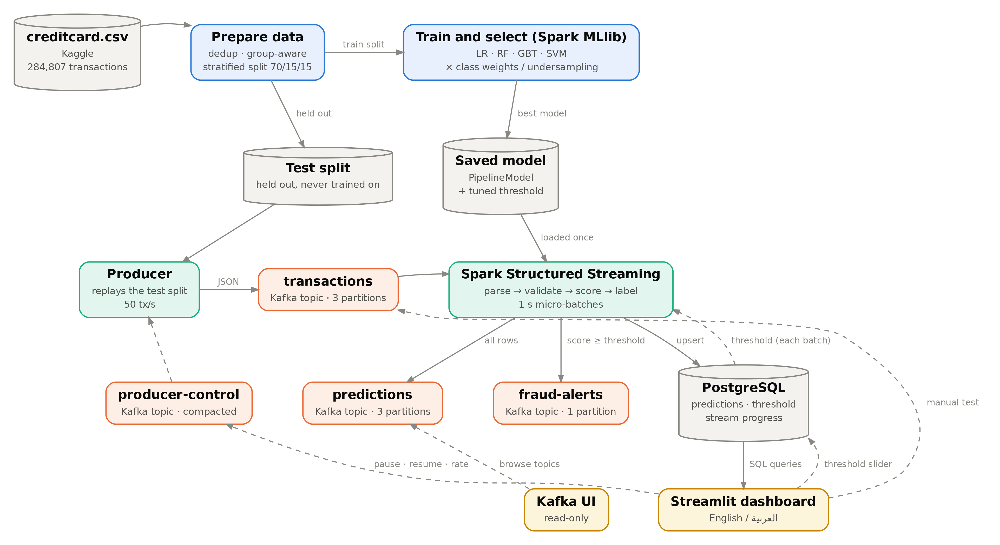
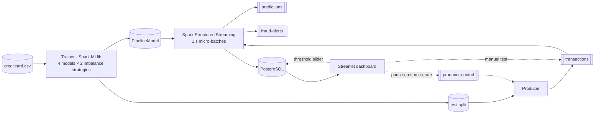

# Real-Time Credit Card Fraud Detection

**Apache Kafka (KRaft) · Spark Structured Streaming · Spark MLlib · PostgreSQL · Streamlit (English / العربية)**

A complete streaming system, built for a Big Data course. A Spark MLlib model, trained offline on the Kaggle *Credit Card Fraud Detection* dataset, scores a live stream of card transactions flowing through Kafka. Every result is written back to Kafka and PostgreSQL and shown on a bilingual dashboard. The whole stack starts with one command, `docker compose up`, on Windows with Docker Desktop.

| | |
|---|---|
| Deployed model | Random Forest, class weights: **test AUC-PR 0.828** (95% CI 0.750–0.906), precision 0.964, recall 0.757 |
| Stream | **51 tx/s**, end-to-end latency **p50 1.7 s / p95 2.6 s** (event → stored in PostgreSQL) |
| Quality | **491 unit tests** (95.9% coverage), **11 end-to-end tests**, independent code review ([REVIEW.md](REVIEW.md)) |

---

## Contents

1. [Architecture](#1-architecture)
2. [Prerequisites (Windows)](#2-prerequisites-windows)
3. [Dataset setup](#3-dataset-setup)
4. [Run it, step by step](#4-run-it-step-by-step)
5. [Train, start, stop, reset](#5-train-start-stop-reset)
6. [URLs](#6-urls)
7. [Tests](#7-tests)
8. [Manual UI test checklist](#8-manual-ui-test-checklist)
9. [Model results](#9-model-results)
10. [Streaming performance](#10-streaming-performance)
11. [Configuration](#11-configuration)
12. [Project structure](#12-project-structure)
13. [Troubleshooting (Windows / Docker)](#13-troubleshooting-windows--docker)
14. [Further documents](#14-further-documents)

---

## 1. Architecture





| Component | What it does |
|---|---|
| **Trainer** (`src/training`) | Removes exact duplicates, then makes a **group-aware, exactly stratified 70/15/15 split**: rows that differ only in `Time` stay together. It compares **Logistic Regression, Random Forest, Gradient-Boosted Trees and Linear SVM**, each with **class weights** and with **undersampling** (16 grid fits). The best is chosen by **validation AUC-PR**, the alert threshold is tuned for **max F1 on validation**, and the test split is used only for the final report. Outputs: the Spark `PipelineModel`, `metrics.json`, figures and `docs/RESULTS.md`. |
| **Producer** (`src/producer`) | Replays **only the held-out test split** to the `transactions` topic at 50 tx/s (configurable), looping forever. It obeys live **pause / resume / rate** commands from the compacted `producer-control` topic. |
| **Kafka 4.1** (KRaft, no ZooKeeper) | Topics `transactions` (3 partitions), `predictions` (3), `fraud-alerts` (1) and `producer-control` (1, compacted), created by `kafka-init`. |
| **Stream processor** (`src/streaming`) | One Structured Streaming query with checkpointing. The streaming plan parses, validates, scores and enriches each transaction. Each micro-batch is then labelled with the **live threshold** and written to `predictions`, to `fraud-alerts` (if flagged) and to PostgreSQL (idempotent upsert). |
| **PostgreSQL 17** | Stores predictions (pruned after 6 h), the shared alert threshold, and Spark progress events. |
| **Dashboard** (`src/dashboard`) | Five pages: Live Monitor, Model Performance, Test a Transaction, System Health, Architecture / About. **English and Arabic** (right-to-left). |
| **Kafka UI** | A read-only browser for topics and messages. |

The full design (message schemas, decisions, risks) is in [PLAN.md](PLAN.md).

---

## 2. Prerequisites (Windows)

| Requirement | Notes |
|---|---|
| Windows 10 (21H2 or later) or Windows 11 | |
| **Docker Desktop** with the **WSL2 backend** | Settings → General → "Use the WSL 2 based engine". Check with `docker info`. |
| WSL2 | `wsl --status` should show *Default Version: 2*. To install or update: `wsl --install` / `wsl --update` (as Administrator). |
| RAM | 8 GB minimum (16 GB recommended). The running stack uses about **2.6 GB**, about 5.5 GB while the model trains. |
| Disk | About 6 GB for images, plus 150 MB for the dataset. |
| Internet | Needed **once**, to pull and build images. After that the stack runs offline. |
| Git (optional) | To clone the repository. |

You don't need Python, Java or Spark on Windows: everything runs in containers, including the tests.

---

## 3. Dataset setup

The dataset is **not** in the repository (it is git-ignored).

**Option A: manual download (recommended)**

1. Open **https://www.kaggle.com/datasets/mlg-ulb/creditcardfraud** and sign in (a free account).
2. Click **Download** to get `archive.zip` (about 66 MB).
3. Extract **`creditcard.csv`** (about 144 MB) into the project's `data\raw\` folder:
   ```
   realtime-fraud-detection-kafka-spark\data\raw\creditcard.csv
   ```
4. Check it: this should print **284808** (284,807 rows plus the header).
   ```powershell
   (Get-Content .\data\raw\creditcard.csv | Measure-Object -Line).Lines
   ```

**Option B: Kaggle API.** Put your API token in `%USERPROFILE%\.kaggle\kaggle.json` (Kaggle → Settings → API → *Create New Token*), then run `.\run.ps1 download-data`.

If the file is missing, the trainer stops with a message that contains these instructions.

---

## 4. Run it, step by step

Open **PowerShell** in the project folder.

```powershell
# 0. (once) allow local scripts for this session if PowerShell blocks run.ps1
Set-ExecutionPolicy -Scope Process -ExecutionPolicy Bypass

# 1. Check Docker, create .env (with a random database password), check the dataset, build the images
.\run.ps1 setup

# 2. Start everything and wait until every service is healthy.
#    The first start trains the model first (about 8 min with 4 CPUs); later starts skip training.
.\run.ps1 up

# 3. Open the dashboard
start http://localhost:8501
```

`.\run.ps1 up` runs `docker compose up -d --build` and waits for the health checks. `docker compose up` on its own works too.

All helper commands:

| Command | What it does |
|---|---|
| `.\run.ps1 setup` | Check Docker, create `.env`, check the dataset, build the images |
| `.\run.ps1 download-data` | Download the dataset with the Kaggle API (optional) |
| `.\run.ps1 train` | Retrain the model; stops and then recreates the producer and stream processor |
| `.\run.ps1 up` | Start the stack and wait until healthy; prints the URLs |
| `.\run.ps1 down` | Stop the stack (keeps all data) |
| `.\run.ps1 reset` | Stop and **delete** Kafka, PostgreSQL and checkpoint volumes (asks first; never touches `data\` or `models\`) |
| `.\run.ps1 status` | Container status and health |
| `.\run.ps1 logs [service]` | Follow logs, e.g. `.\run.ps1 logs stream-processor` |
| `.\run.ps1 test` | Unit tests plus coverage (in Docker) |
| `.\run.ps1 e2e` | End-to-end tests against the running stack |
| `.\run.ps1 screenshots` | Capture every dashboard page (EN + AR) to `docs\screenshots\` |
| `.\run.ps1 diagrams` | Re-render `docs\figures\architecture.{svg,png}` from the Mermaid source |

---

## 5. Train, start, stop, reset

| Task | Command | Notes |
|---|---|---|
| **Train / retrain** | `.\run.ps1 train` | About 8 minutes. Writes `models\best_model\`, `models\metrics.json`, `data\processed\*.parquet`, `docs\figures\*.png` and `docs\RESULTS.md`. If the stack is running, the producer and stream processor are stopped and then recreated with the new model. |
| **Start** | `.\run.ps1 up` | Idempotent; also rebuilds images if code changed. |
| **Stop** | `.\run.ps1 down` | Predictions, Kafka messages and the Spark checkpoint are kept. |
| **Pause the stream only** | Dashboard sidebar → **Pause** | The stack keeps running. |
| **Reset** | `.\run.ps1 reset` | Clears topics, stored predictions and the checkpoint (for example after changing the streaming code). Type `yes` to confirm. |
| **Change the rate permanently** | `PRODUCER_RATE=…` in `.env`, then `.\run.ps1 up` | The dashboard's rate control overrides this until you reset. |

---

## 6. URLs

All ports are bound to `127.0.0.1` only (nothing is exposed to your network) and can be changed in `.env`.

| Service | URL |
|---|---|
| **Dashboard** | **http://localhost:8501** (Arabic: http://localhost:8501/?lang=ar) |
| Kafka UI | http://localhost:8081 |
| Spark UI (Structured Streaming tab) | http://localhost:4040 |
| Kafka (host tools) | `localhost:9094` |
| PostgreSQL (host tools) | `localhost:15432`, database `fraud`, user `fraud`, password in `.env` |

---

## 7. Tests

### Unit tests

```powershell
.\run.ps1 test
```

**491 tests** run in about 3 minutes, inside the Spark image with a local `SparkSession`. Coverage is **95.9%**, and the HTML report is in `reports\coverage\index.html`. Kafka and PostgreSQL are replaced by in-memory fakes. Coverage includes:
- config and message schemas;
- the exact, group-aware split;
- feature engineering;
- model save/load/predict;
- metrics, including a regression test that AUC-PR is not binned;
- producer pacing and control;
- the stream transforms on static DataFrames, including poison-pill messages;
- the sinks, the listener and every dashboard helper.

### End-to-end tests

The stack must be running first (`.\run.ps1 up`):

```powershell
.\run.ps1 e2e
```

**11 tests** against the live system:
- topics and their configuration;
- the producer is publishing;
- Spark reports progress;
- predictions reach Kafka and PostgreSQL;
- **a known fraud produces an alert**, and a known legitimate transaction does not;
- a threshold change reaches Spark;
- the dashboard and Kafka UI respond over HTTP;
- pause and resume.

The run writes **[docs/E2E_REPORT.md](docs/E2E_REPORT.md)** with latency and throughput.

---

## 8. Manual UI test checklist

Open **http://localhost:8501** and follow this list. Each line says what to do and what you should see.

**Live Monitor (default page)**
- [ ] Within a few seconds, **Processed** increases every 2 s. **Throughput (60 s)** is about **50 tx/s**, **Avg latency** is about 0.5–1 s, and the **fraud rate** is about 0.1–0.2%.
- [ ] **Live transaction feed** shows new rows with *✓ OK* decisions. The **Fraud alerts** table shows rows with *🚨 FRAUD* on a red background.
- [ ] The three charts update: the score histogram (with a vertical threshold line), frauds per minute (flagged vs actual), and amounts.
- [ ] **Live model quality** shows precision about 0.9–1.0 and recall about 0.7–0.8.

**Sidebar controls**
- [ ] Drag **Alert threshold** to about 0.9. A toast says it was saved, and the alerts table, *Flagged as fraud* and fraud rate drop. **System Health → Active threshold (DB)** now shows 0.900.
- [ ] Click **Reset to model default**. The threshold returns to **0.4797**.
- [ ] Click **Pause**. The state shows *Paused*. After about 30 s the Live Monitor warns that there are no new predictions, and **System Health → Producer** shows *Paused*.
- [ ] Click **Resume**. Data flows again.
- [ ] Set **Rate** to 200 and click **Apply rate**. Throughput climbs to about 200 tx/s. Set it back to 50.

**Model Performance**
- [ ] The selected model is *Random Forest · class weights*: AUC-PR 0.8283, threshold 0.4797.
- [ ] The comparison table has 8 rows, with the selected row in bold and a *Test AP 95% CI* column.
- [ ] The bar chart shows test AUC-PR per model, with undersampling hatched.
- [ ] The **Precision–Recall**, **ROC**, **Confusion matrix** (TP 53, FP 2, FN 17) and **Threshold sweep** tabs all render.

**Test a Transaction**
- [ ] Click **🎲 Random fraud**. A sample summary appears (*Fraud*, amount, hour).
- [ ] Click **📨 Send via Kafka**. Within about 2–3 s you see a gauge, a decision (usually **🚨 FRAUD**; some frauds are genuinely missed), the score, the threshold used, both latencies and the transaction ID. The row also appears under *Recent manual tests*.
- [ ] Change the **Amount** or open **Advanced: PCA features V1–V28**, edit a value and send again. The true class now shows as *unknown (edited)*.

**System Health**
- [ ] Four green boxes: Kafka, PostgreSQL, Spark (last progress a few seconds ago) and Producer (about 50 tx/s).
- [ ] Topic offsets grow on each refresh; **Lag** stays small (below a few hundred messages).

**Architecture / About**
- [ ] The architecture diagram, component descriptions, dataset facts and tech stack are shown.

**Language**
- [ ] Select **العربية** in the sidebar. Everything switches to Arabic with right-to-left layout, while tables and charts stay left-to-right. Opening http://localhost:8501/?lang=ar starts in Arabic.

**Kafka UI (http://localhost:8081)**
- [ ] Topics → `transactions` → **Messages** shows JSON transactions. `fraud-alerts` shows only flagged predictions. `producer-control` holds the last command.

**Spark UI (http://localhost:4040)**
- [ ] The **Structured Streaming** tab shows the `fraud-scoring` query with input rate, process rate and batch duration charts.

---

## 9. Model results

Test split: **42,557 transactions, 70 frauds** (0.16%). Selection used validation AUC-PR, and each row's threshold maximises F1 on validation. Full details: [docs/RESULTS.md](docs/RESULTS.md).

| Model | Imbalance | Val AUC-PR | **Test AUC-PR** | Test AP 95% CI | ROC-AUC | Precision | Recall | F1 | Threshold |
|---|---|---:|---:|:---:|---:|---:|---:|---:|---:|
| Logistic Regression | class weights | 0.764 | 0.715 | 0.608–0.828 | 0.966 | 0.754 | 0.743 | 0.748 | 0.958 |
| Logistic Regression | undersampling | 0.808 | 0.738 | 0.625–0.846 | 0.970 | 0.825 | 0.743 | 0.782 | 0.982 |
| **Random Forest ★** | **class weights** | **0.878** | **0.828** | **0.750–0.906** | 0.982 | **0.964** | 0.757 | **0.848** | 0.480 |
| Random Forest | undersampling | 0.833 | 0.760 | 0.646–0.869 | 0.973 | 0.900 | 0.643 | 0.750 | 0.910 |
| Gradient-Boosted Trees | class weights | 0.790 | 0.694 | 0.584–0.803 | 0.948 | 0.906 | 0.686 | 0.780 | 0.972 |
| Gradient-Boosted Trees | undersampling | 0.589 | 0.544 | 0.446–0.702 | 0.979 | 0.732 | 0.743 | 0.738 | 0.977 |
| Linear SVM (Platt) | class weights | 0.703 | 0.678 | 0.567–0.795 | 0.968 | 0.804 | 0.586 | 0.678 | 0.169 |
| Linear SVM (Platt) | undersampling | 0.852 | 0.755 | 0.647–0.863 | 0.976 | 0.897 | 0.743 | 0.813 | 0.144 |

The deployed model (★) catches **53 of 70** test frauds with **2 false alarms** among 42,487 legitimate transactions.

Key points for the report:
- **Why AUC-PR:** ROC-AUC barely separates the models (0.95–0.98) because legitimate transactions dominate. AUC-PR ranges from 0.54 to 0.83 and reflects the precision analysts actually experience.
- **Imbalance:** class weights work best for tree ensembles, which keep all the data. Undersampling slightly helps the linear models.
- **Uncertainty:** with only 70 test frauds the confidence intervals are wide and the top models overlap, so the ranking among them is not conclusive.
- **No leakage:** exact duplicates are removed before splitting; 12,446 "feature twins" (identical except for `Time`) are kept in a single split; the label is never a feature; the stream replays the test split only.
- **The score is a ranking, not a calibrated probability.** Only the SVM is calibrated (Platt), so the dashboard calls it a *fraud score*.

Figures in `docs/figures/`: `pr_curves.png`, `roc_curves.png`, `model_comparison.png`, `threshold_sweep.png`, `confusion_matrix.png`.

---

## 10. Streaming performance

Measured by the e2e test over 60 s of steady replay traffic at 50 tx/s ([docs/E2E_REPORT.md](docs/E2E_REPORT.md)):

| Metric | Value |
|---|---:|
| Throughput | **51 tx/s** |
| Processing latency p50 / p95 (event → micro-batch start) | 578 / 1,198 ms |
| **End-to-end latency p50 / p95** (event → stored in PostgreSQL) | **1,673 / 2,557 ms** |
| Micro-batch duration | ~0.8 s (1 s trigger) |
| Memory, whole stack | ~2.6 GB |

The model is applied **inside the streaming plan**, so the pipeline is built and the forest broadcast once, not per batch. That halved end-to-end latency compared with the first version (see PROGRESS.md, Phase 6).

---

## 11. Configuration

Every setting lives in **`.env`** (created from [.env.example](.env.example) by `.\run.ps1 setup`). The code reads it through typed settings in `src/common/config.py`. Frequently changed keys:

| Key | Default | Meaning |
|---|---|---|
| `PRODUCER_RATE` / `PRODUCER_LOOP` | 50 / true | Start-up replay rate and looping |
| `ALERT_THRESHOLD_OVERRIDE` | *(empty)* | Force a threshold (0.001–0.999) instead of the tuned one |
| `PREDICTIONS_RETENTION_HOURS` | 6 | How long predictions are kept in PostgreSQL |
| `TRIGGER_INTERVAL_SECONDS` | 1 | Spark micro-batch trigger |
| `*_HOST_PORT` | 8501, 8081, 4040, 9094, 15432 | Published ports (change them if one is taken) |
| `*_MEM_LIMIT`, `TRAINER_CPUS`, `STREAM_CPUS` | see file | Container resource limits |
| `RANDOM_SEED`, `UNDERSAMPLE_RATIO` | 42, 10 | Training reproducibility and undersampling ratio |

`.env` contains the database password and is git-ignored. Never commit it.

---

## 12. Project structure

```
├── src/
│   ├── common/      config, message schemas, logging, Kafka/DB/Spark helpers
│   ├── training/    data prep (dedup, group-aware split), features, models, evaluation, report, train_model.py
│   ├── producer/    replay of the test split, rate limiter, control-topic listener
│   ├── streaming/   stream_processor.py, transforms, foreachBatch fan-out, sinks, threshold, listener
│   └── dashboard/   app.py, sidebar, views/ (5 pages), helpers/ (pure, unit-tested logic)
├── tests/unit/      491 unit tests      tests/e2e/   11 end-to-end tests
├── docker/          spark.Dockerfile, app.Dockerfile, kafka/create-topics.sh, postgres/init.sql
├── docker-compose.yml, .env.example, run.ps1, pyproject.toml, requirements/ (pinned + constraints.txt)
├── data/raw/        creditcard.csv (you add it)     models/   trained model + metrics (generated)
├── docs/            RESULTS.md, E2E_REPORT.md, DEMO_SCRIPT.md, figures/, screenshots/
└── PLAN.md · PROGRESS.md · REVIEW.md · README.md
```

---

## 13. Troubleshooting (Windows / Docker)

| Symptom | Cause and fix |
|---|---|
| `run.ps1 cannot be loaded because running scripts is disabled` | Run `Set-ExecutionPolicy -Scope Process -ExecutionPolicy Bypass` in that PowerShell window, or `powershell -ExecutionPolicy Bypass -File .\run.ps1 up`. |
| `Docker Desktop is not running` | Start Docker Desktop and wait until it shows *Engine running*. If it fails to start: `wsl --update` (as Administrator), reboot, and check that virtualization is enabled in the BIOS. |
| `ports are not available: … 127.0.0.1:15432` (or 8501, 8081, 4040, 9094) | Another program uses that port. Find it with `Get-NetTCPConnection -LocalPort 15432 -State Listen`, then change the matching `*_HOST_PORT` in `.env` and run `.\run.ps1 up`. (On the development machine a local PostgreSQL held 5433, which is why the default is 15432.) |
| A container keeps restarting, or `Exited (137)` | Out of memory. Give Docker more: create `%UserProfile%\.wslconfig` with `[wsl2]` and `memory=8GB`, run `wsl --shutdown` and restart Docker Desktop. Or lower `TRAINER_DRIVER_MEMORY` / `*_MEM_LIMIT` in `.env`. |
| `range of CPUs is from 0.01 to N` | `TRAINER_CPUS` or `STREAM_CPUS` is above what Docker has. Lower it in `.env`. (`setup` adjusts it automatically for a new `.env`.) |
| `/bin/bash^M: bad interpreter`, or `kafka-init` fails | Windows line endings. The repo's `.gitattributes` forces LF, but files checked out *before* it existed keep CRLF. Re-clone the repository, or, if you have **no uncommitted changes** (this discards them), run `git rm -r --cached . ; git reset --hard`. The containers also strip `\r` from scripts. |
| The trainer exits with `Dataset not found` | Put `creditcard.csv` in `data\raw\` (see [section 3](#3-dataset-setup)). |
| The first `up` seems stuck at "waiting for: stream-processor" | On the first run the trainer runs before streaming starts (about 8 min). Follow it with `.\run.ps1 logs trainer`. |
| The stream processor is unhealthy after you changed streaming code | The Spark checkpoint no longer matches the query. Run `.\run.ps1 reset` (deletes topics and stored predictions), then `.\run.ps1 up`. |
| The dashboard says *Database unavailable* | Postgres isn't healthy. Check `.\run.ps1 status` and `.\run.ps1 logs postgres`. |
| The dashboard says *Producer state unknown* | Kafka isn't reachable from the dashboard: check `.\run.ps1 logs kafka`. The controls stay disabled on purpose until the state is known. |
| No fraud alerts for a while | Frauds are rare (about 1 in 600) and arrive in bursts. Use **Test a Transaction → Random fraud**, or raise the rate. |
| The first build is slow or fails to download | The first `setup` downloads about 1.5 GB (images, Python packages, Spark connector JARs). Check your internet or proxy and re-run `.\run.ps1 setup`. |
| `docker-compose: command not found` | Use Docker Compose v2, i.e. `docker compose` with a space; it comes with Docker Desktop. |

---

## 14. Further documents

| Document | Content |
|---|---|
| [PLAN.md](PLAN.md) | Approved design: architecture, message schemas, decisions, versions, risks |
| [PROGRESS.md](PROGRESS.md) | What was done in each phase, problems found and fixed, measurements |
| [REVIEW.md](REVIEW.md) | Independent review (Claude Fable 5.2) and the resolution of every finding |
| [docs/RESULTS.md](docs/RESULTS.md) | Full training results, confidence intervals, methodology notes |
| [docs/E2E_REPORT.md](docs/E2E_REPORT.md) | Latest end-to-end latency and throughput measurement |
| [docs/DEMO_SCRIPT.md](docs/DEMO_SCRIPT.md) | A 10-minute presentation script |
| [docs/screenshots/](docs/screenshots/) | Every dashboard page in English and Arabic |
