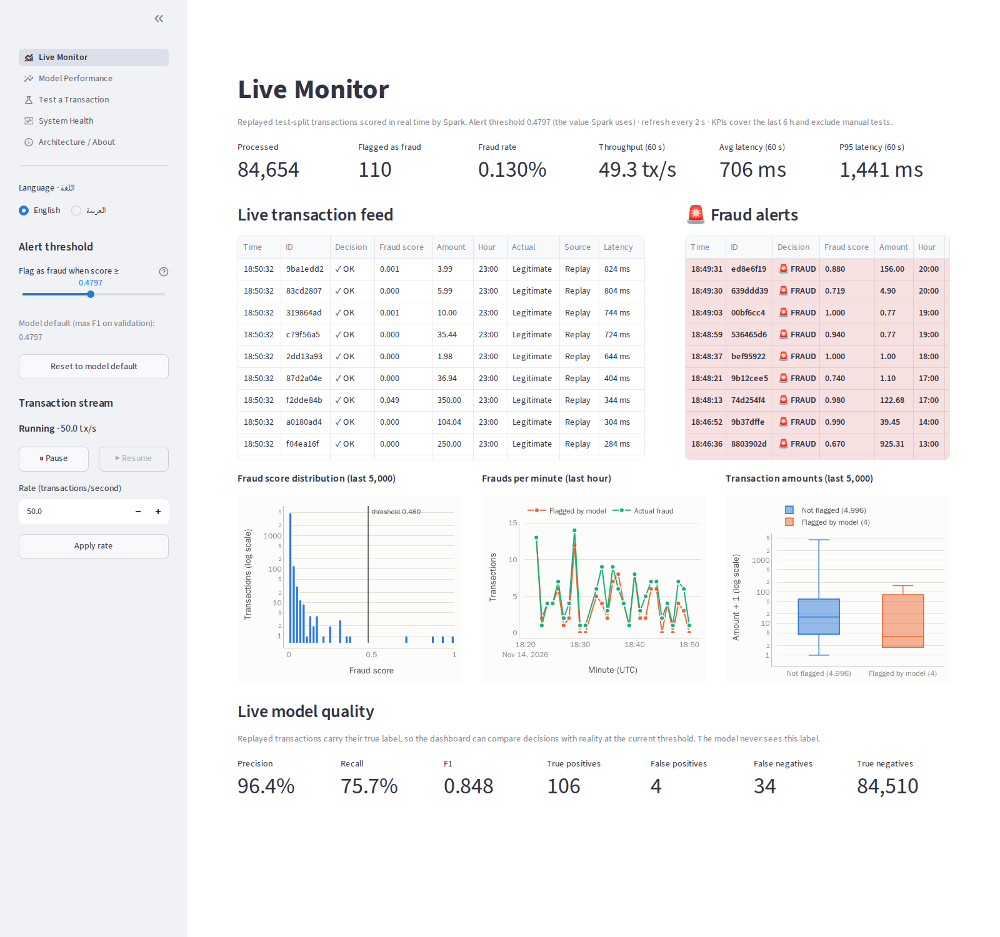
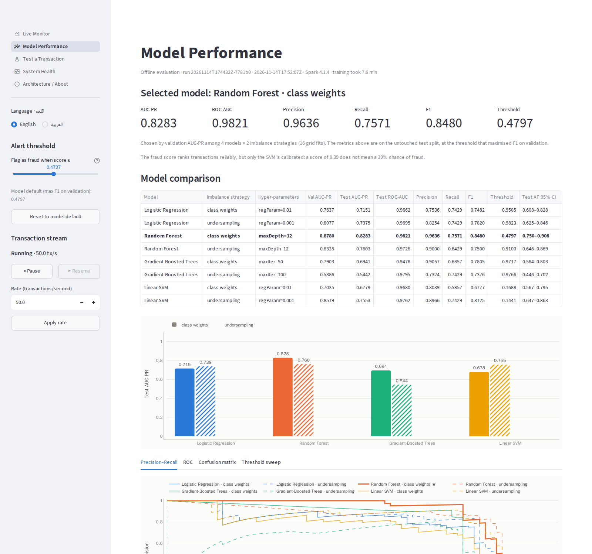
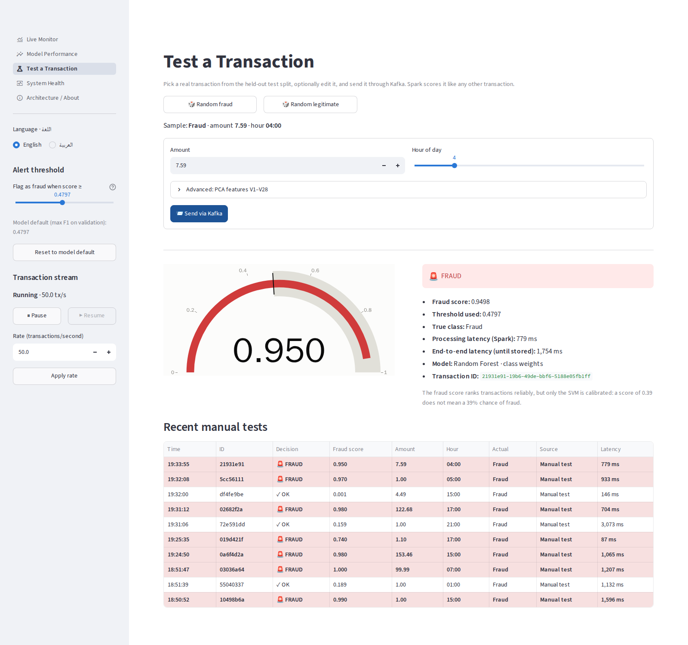
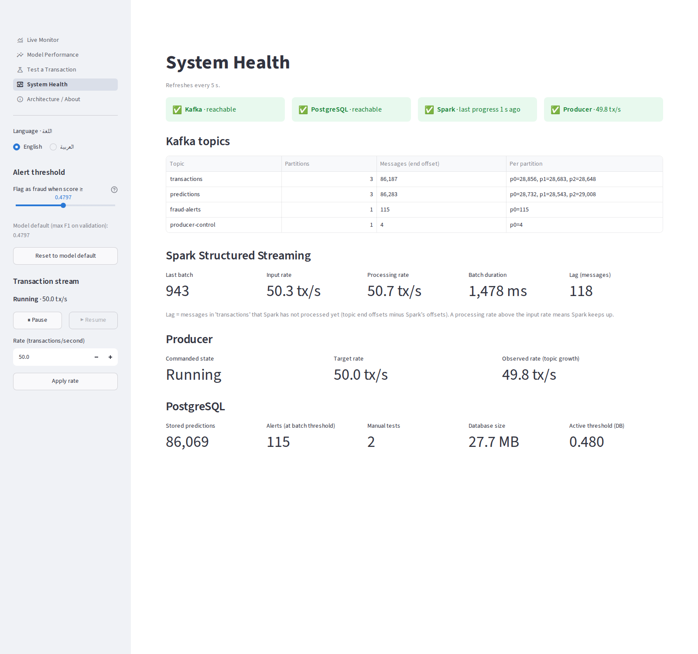
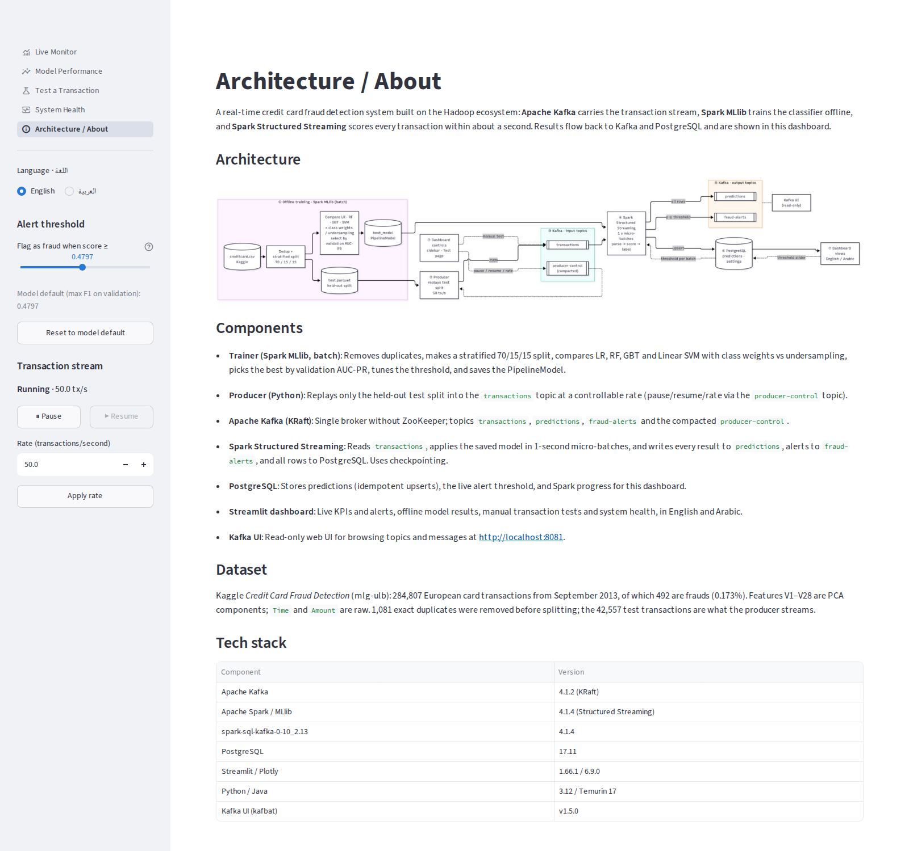
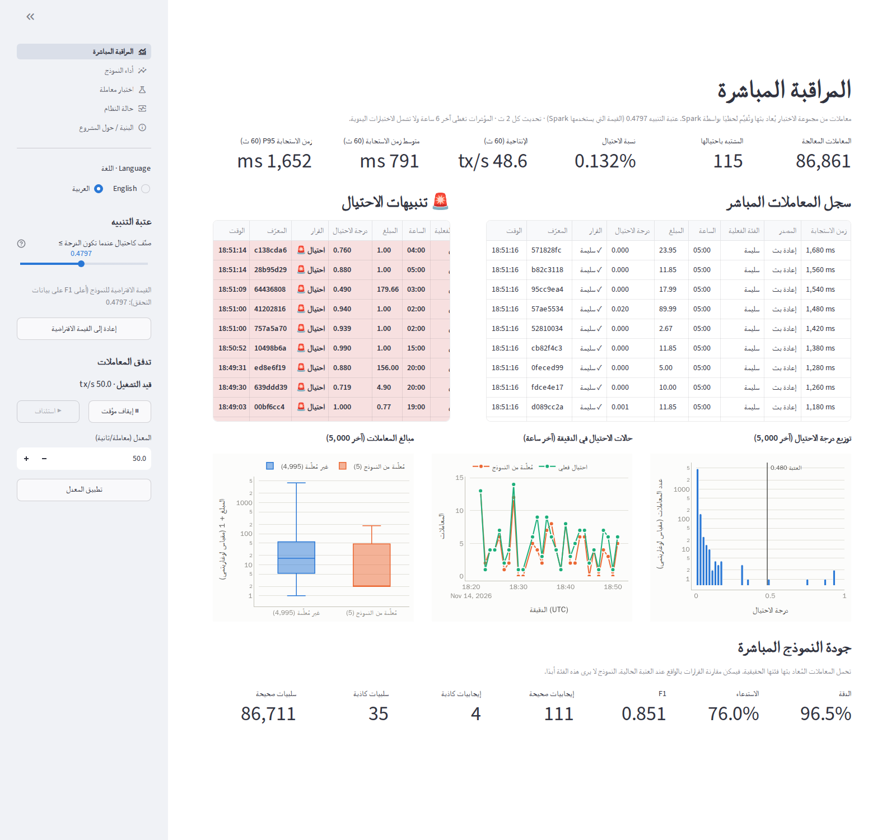

# Dashboard Guide

The dashboard is a **Streamlit** web app at **http://localhost:8501**. It has five pages and a sidebar that is the same on every page. It works in **English and Arabic**, and the live panels refresh automatically, so there is no need to reload the page.

| Page | Question it answers |
|---|---|
| [Live Monitor](#1-live-monitor) | What is happening in the stream right now? |
| [Model Performance](#2-model-performance) | How good is the model, and why was it chosen? |
| [Test a Transaction](#3-test-a-transaction) | What does the system decide for one transaction I choose? |
| [System Health](#4-system-health) | Is every component running and keeping up? |
| [Architecture / About](#5-architecture--about) | How is the system built? |

---

## Sidebar (on every page)

The sidebar is how you **control the running system**. Each change takes effect immediately.

- **Language:** switch between English and العربية. The link `http://localhost:8501/?lang=ar` opens the dashboard directly in Arabic.
- **Alert threshold:** a transaction is flagged as fraud when its score is at or above this value. When you move the slider, the new value is saved in PostgreSQL and Spark uses it from the next micro-batch, about 1 second later. **Reset to model default** restores the tuned value, 0.4797, which gave the best F1 score on the validation split.
- **Transaction stream:** shows whether the producer is *Running* or *Paused* and its rate. **Pause**, **Resume** and **Apply rate** send a command through the Kafka `producer-control` topic, and the producer applies it right away. If Kafka can't be reached, the controls are disabled and the sidebar shows a warning.

## 1. Live Monitor

The main page. It refreshes every **2 seconds** and has four parts:

1. **KPI row:** transactions processed, flagged as fraud, fraud rate, throughput, and average and 95th-percentile latency over the last 60 s.
2. **Live transaction feed** and **Fraud alerts:** the newest scored transactions, and the newest flagged ones, highlighted in red.
3. **Charts:**
   - **Fraud score distribution**, with the threshold line.
   - **Frauds per minute:** flagged by the model compared with actual frauds.
   - **Transaction amounts:** flagged compared with not flagged.
4. **Live model quality:** precision, recall, F1 and the confusion counts. These can be computed because each replayed transaction carries its true label, which the model never sees.

> **Tip:** move the threshold slider and watch precision and recall change. A lower threshold catches more fraud but raises more false alarms.

## 2. Model Performance

This page shows the **offline training results** that produced the deployed model. It doesn't change while the stream runs.

- **Selected model** (Random Forest with class weights): AUC-PR, ROC-AUC, precision, recall, F1 and the threshold, all measured on the untouched test split.
- **Model comparison:** a table of all 8 model × imbalance-strategy combinations, with 95% confidence intervals, and a bar chart of test AUC-PR. In the chart, solid bars are class weights and hatched bars are undersampling.
- **Tabs:**
  - precision–recall curves;
  - ROC curves;
  - the confusion matrix;
  - a threshold sweep showing how precision and recall change with the threshold.
- **Expandable sections:** the dataset and split sizes, and all 16 grid candidates.

## 3. Test a Transaction

This page sends **one transaction of your choice through the real pipeline**: Kafka → Spark → PostgreSQL.

1. Click **Random fraud** or **Random legitimate** to load a real transaction from the test split.
2. Optionally edit the **amount**, the **hour of day**, or the 28 PCA features (under *Advanced*).
3. Click **Send via Kafka**. The page waits up to 15 s for Spark's answer.
4. The result appears:
   - a **score gauge**;
   - the **FRAUD / OK** decision;
   - the threshold used;
   - the true class (shown as "unknown" if you edited the transaction);
   - Spark's processing latency and the end-to-end latency.

The **Recent manual tests** table keeps a history of your tests. Manual tests are tagged as such and left out of the Live Monitor KPIs.

## 4. System Health

This is the first page to check when something looks wrong. It refreshes every 5 seconds.

- **Status row:** whether Kafka and PostgreSQL can be reached, whether Spark reported progress in the last 60 s, and the producer's rate. Green means healthy; red means there is a problem.
- **Kafka topics:** the partitions and message count of each topic.
- **Spark Structured Streaming:** last batch ID, input rate, processing rate, batch duration and **lag**, the number of messages still waiting to be processed. If the processing rate is above the input rate, Spark is keeping up.
- **Producer:** the commanded state, the target rate and the actual rate.
- **PostgreSQL:** the number of stored predictions, alerts and manual tests, the database size, and the active threshold.

## 5. Architecture / About

This page has:
- the **architecture diagram** in the current language;
- a short description of each component;
- a summary of the dataset;
- the versions of the technologies used.

## Arabic mode

Selecting **العربية** in the sidebar translates every page and switches the layout to **right-to-left**. Numbers, IDs and units stay left-to-right, so they read correctly.

## Other web interfaces

| Interface | URL | Use |
|---|---|---|
| Kafka UI | http://localhost:8081 | Browse topics and read the actual messages (read-only) |
| Spark UI | http://localhost:4040 | Spark jobs, stages and the streaming query's statistics |

---

*Every page, in English and Arabic: [screenshots/](screenshots/). How the whole system works: [SYSTEM_OVERVIEW.md](SYSTEM_OVERVIEW.md).*
