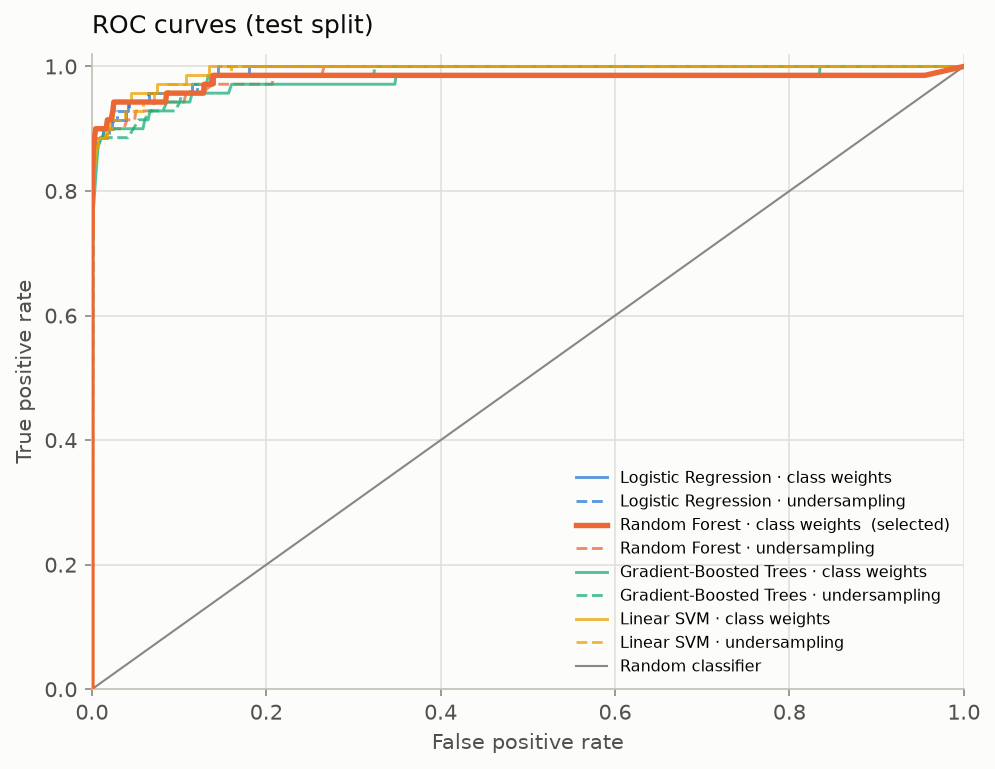
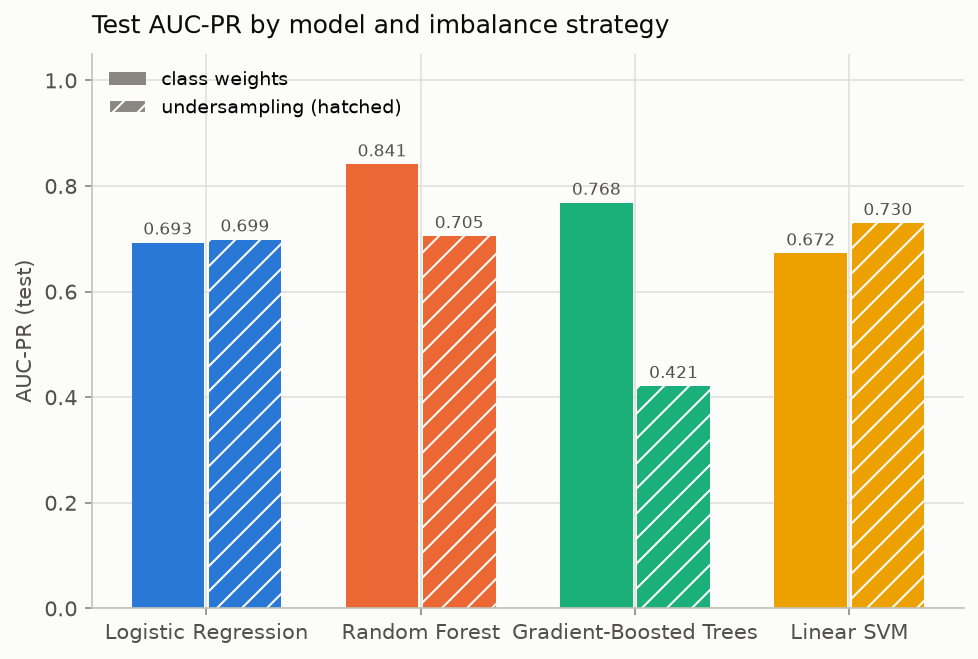
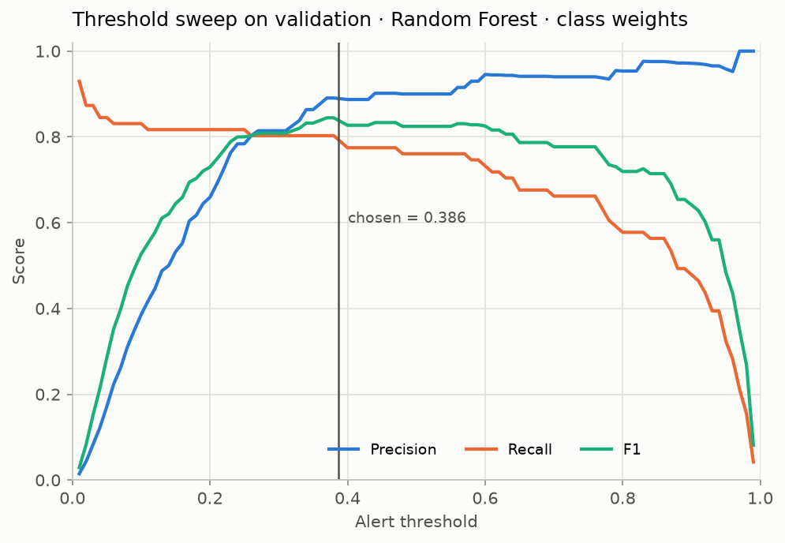

# Model Results

Generated by the trainer on 2026-11-14T16:57:37Z (run `20261114T165201Z-065c95`, Spark 4.1.4, seed 42, training time 5.6 min).

## Dataset

| Set | Rows | Frauds | Fraud rate |
|---|---:|---:|---:|
| Raw CSV | 284,807 | 492 | 0.1727% |
| After removing 1,081 exact duplicates | 283,726 | 473 | 0.1667% |
| Train split | 198,610 | 332 | 0.1672% |
| Val split | 42,559 | 71 | 0.1668% |
| Test split | 42,557 | 70 | 0.1645% |

## Model comparison

Each row is the best hyper-parameter configuration of a model × imbalance strategy, selected by **validation AUC-PR**. The alert threshold of each row maximises F1 on the validation split; precision, recall and F1 are measured on the **test split** at that threshold.

| Model | Imbalance strategy | Params | Val AUC-PR | Test AUC-PR | Test ROC-AUC | Precision | Recall | F1 | Threshold |
|---|---|---|---:|---:|---:|---:|---:|---:|---:|
| Logistic Regression | class weights | regParam=0.01 | 0.7603 | 0.6928 | 0.9909 | 0.6761 | 0.6857 | 0.6809 | 0.945 |
| Logistic Regression | undersampling | regParam=0.001 | 0.7804 | 0.6985 | 0.9913 | 0.7089 | 0.8000 | 0.7517 | 0.947 |
| **Random Forest** | class weights | maxDepth=12 | 0.7985 | **0.8408** | 0.9801 | 0.7671 | 0.8000 | 0.7832 | 0.386 |
| Random Forest | undersampling | maxDepth=12 | 0.7423 | 0.7050 | 0.9873 | 0.8000 | 0.8000 | 0.8000 | 0.760 |
| Gradient-Boosted Trees | class weights | maxIter=100 | 0.4776 | 0.7679 | 0.9756 | 0.8226 | 0.7286 | 0.7727 | 0.926 |
| Gradient-Boosted Trees | undersampling | maxIter=100 | 0.3553 | 0.4210 | 0.9863 | 0.6790 | 0.7857 | 0.7285 | 0.988 |
| Linear SVM | class weights | regParam=0.01 | 0.7596 | 0.6722 | 0.9931 | 0.6410 | 0.7143 | 0.6757 | 0.153 |
| Linear SVM | undersampling | regParam=0.001 | 0.7869 | 0.7295 | 0.9913 | 0.8116 | 0.8000 | 0.8058 | 0.201 |

## Selected model: Random Forest · class weights

* Hyper-parameters: `{'maxDepth': 12}`
* Alert threshold (max F1 on validation): **0.3863**
* Test AUC-PR **0.8408**, ROC-AUC 0.9801, average precision 0.8412
* Test precision 0.7671, recall 0.8000, F1 0.7832

| | Predicted legitimate | Predicted fraud |
|---|---:|---:|
| **Actual legitimate** | 42,470 (TN) | 17 (FP) |
| **Actual fraud** | 14 (FN) | 56 (TP) |

## All grid candidates (validation)

| Model | Strategy | Params | Val AUC-PR | Val ROC-AUC | Fit time (s) |
|---|---|---|---:|---:|---:|
| Logistic Regression | class weights | regParam=0.001 | 0.7594 | 0.9735 | 9.0 |
| Logistic Regression | class weights | regParam=0.01 | 0.7603 | 0.9757 | 4.7 |
| Random Forest | class weights | maxDepth=8 | 0.7649 | 0.9731 | 28.9 |
| Random Forest | class weights | maxDepth=12 | 0.7985 | 0.9552 | 43.6 |
| Gradient-Boosted Trees | class weights | maxIter=50 | 0.4167 | 0.9257 | 28.7 |
| Gradient-Boosted Trees | class weights | maxIter=100 | 0.4776 | 0.9326 | 52.6 |
| Linear SVM | class weights | regParam=0.001 | 0.7187 | 0.9796 | 19.2 |
| Linear SVM | class weights | regParam=0.01 | 0.7596 | 0.9813 | 18.8 |
| Logistic Regression | undersampling | regParam=0.001 | 0.7804 | 0.9739 | 3.4 |
| Logistic Regression | undersampling | regParam=0.01 | 0.7686 | 0.9784 | 2.4 |
| Random Forest | undersampling | maxDepth=8 | 0.7400 | 0.9614 | 3.6 |
| Random Forest | undersampling | maxDepth=12 | 0.7423 | 0.9595 | 5.2 |
| Gradient-Boosted Trees | undersampling | maxIter=50 | 0.3544 | 0.9702 | 12.5 |
| Gradient-Boosted Trees | undersampling | maxIter=100 | 0.3553 | 0.9685 | 27.6 |
| Linear SVM | undersampling | regParam=0.001 | 0.7869 | 0.9732 | 14.8 |
| Linear SVM | undersampling | regParam=0.01 | 0.7847 | 0.9750 | 15.7 |

## Methodology notes

* Exact duplicate rows are removed **before** the split, so no identical transaction appears in both training and test data.
* Exact stratified 70/15/15 split (rows ranked by a seeded hash within each class). The test split is used once, for the numbers above, and is the only data replayed by the streaming producer.
* Imbalance: *class weights* = balanced weights n/(2·n_class) on the full training split; *undersampling* = all frauds + legitimate rows sampled at 1:10.
* Linear SVM scores are converted to probabilities with Platt scaling fitted on the validation split (monotonic, so AUCs are unaffected; the tuned threshold is slightly optimistic).
* AUC-PR is MLlib's `areaUnderPR` computed exactly (`numBins=0`; the default 1,000-bin down-sampling distorts AUC-PR when there are only ~70 frauds among ~42k rows). Average precision is scikit-learn's step-wise estimate, reported as a cross-check.

## Figures

