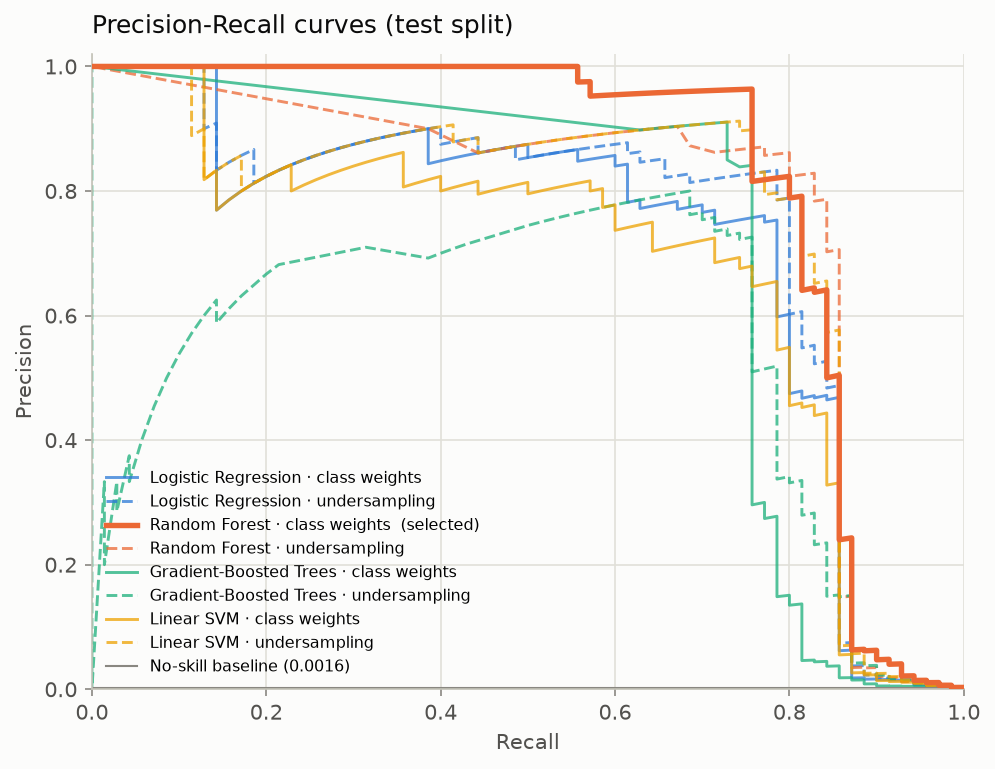
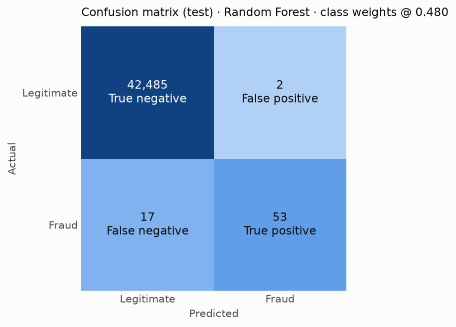

# Model Results

Generated by the trainer on 2026-11-14T17:52:07Z (run `20261114T174432Z-7781b0`, Spark 4.1.4, seed 42, training time 7.6 min).

## Dataset

| Set | Rows | Frauds | Fraud rate |
|---|---:|---:|---:|
| Raw CSV | 284,807 | 492 | 0.1727% |
| After removing 1,081 exact duplicates | 283,726 | 473 | 0.1667% |
| Train split | 198,610 | 332 | 0.1672% |
| Val split | 42,559 | 71 | 0.1668% |
| Test split | 42,557 | 70 | 0.1645% |

**Feature twins:** 12,446 rows in 4,383 groups have identical V1–V28 and Amount and differ only in `Time`. They are kept, but each group is assigned to a single split (0 groups span more than one split), so no feature vector is trained on and then tested.

## Model comparison

Each row is the best hyper-parameter configuration of a model × imbalance strategy, selected by **validation AUC-PR**. The alert threshold of each row maximises F1 on the validation split; precision, recall and F1 are measured on the **test split** at that threshold.

| Model | Imbalance strategy | Params | Val AUC-PR | Test AUC-PR | Test ROC-AUC | Precision | Recall | F1 | Threshold |
|---|---|---|---:|---:|---:|---:|---:|---:|---:|
| Logistic Regression | class weights | regParam=0.01 | 0.7637 | 0.7151 | 0.9662 | 0.7536 | 0.7429 | 0.7482 | 0.958 |
| Logistic Regression | undersampling | regParam=0.001 | 0.8077 | 0.7375 | 0.9695 | 0.8254 | 0.7429 | 0.7820 | 0.982 |
| **Random Forest** | class weights | maxDepth=12 | 0.8780 | **0.8283** | 0.9821 | 0.9636 | 0.7571 | 0.8480 | 0.480 |
| Random Forest | undersampling | maxDepth=12 | 0.8328 | 0.7603 | 0.9728 | 0.9000 | 0.6429 | 0.7500 | 0.910 |
| Gradient-Boosted Trees | class weights | maxIter=50 | 0.7903 | 0.6941 | 0.9478 | 0.9057 | 0.6857 | 0.7805 | 0.972 |
| Gradient-Boosted Trees | undersampling | maxIter=100 | 0.5886 | 0.5442 | 0.9795 | 0.7324 | 0.7429 | 0.7376 | 0.977 |
| Linear SVM | class weights | regParam=0.01 | 0.7035 | 0.6779 | 0.9680 | 0.8039 | 0.5857 | 0.6777 | 0.169 |
| Linear SVM | undersampling | regParam=0.001 | 0.8519 | 0.7553 | 0.9762 | 0.8966 | 0.7429 | 0.8125 | 0.144 |

### Uncertainty: 95% bootstrap confidence intervals (test split)

The test transactions are resampled 1,000 times with the model and threshold fixed. With only ~70 frauds, intervals are wide; models whose intervals overlap cannot be reliably ranked.

| Model | Imbalance strategy | Average precision | Precision | Recall | F1 |
|---|---|---|---|---|---|
| Logistic Regression | class weights | 0.608 – 0.828 | 0.652 – 0.853 | 0.643 – 0.841 | 0.667 – 0.823 |
| Logistic Regression | undersampling | 0.625 – 0.846 | 0.724 – 0.909 | 0.643 – 0.841 | 0.702 – 0.855 |
| Random Forest | class weights | 0.750 – 0.906 | 0.908 – 1.000 | 0.662 – 0.853 | 0.783 – 0.909 |
| Random Forest | undersampling | 0.646 – 0.869 | 0.812 – 0.980 | 0.537 – 0.758 | 0.660 – 0.828 |
| Gradient-Boosted Trees | class weights | 0.584 – 0.803 | 0.821 – 0.980 | 0.585 – 0.792 | 0.698 – 0.855 |
| Gradient-Boosted Trees | undersampling | 0.446 – 0.702 | 0.631 – 0.831 | 0.640 – 0.838 | 0.651 – 0.816 |
| Linear SVM | class weights | 0.567 – 0.795 | 0.697 – 0.915 | 0.471 – 0.707 | 0.578 – 0.769 |
| Linear SVM | undersampling | 0.647 – 0.863 | 0.818 – 0.970 | 0.641 – 0.845 | 0.738 – 0.883 |

## Selected model: Random Forest · class weights

* Hyper-parameters: `{'maxDepth': 12}`
* Alert threshold (max F1 on validation): **0.4797**
* Test AUC-PR **0.8283**, ROC-AUC 0.9821, average precision 0.8286
* Test precision 0.9636, recall 0.7571, F1 0.8480

| | Predicted legitimate | Predicted fraud |
|---|---:|---:|
| **Actual legitimate** | 42,485 (TN) | 2 (FP) |
| **Actual fraud** | 17 (FN) | 53 (TP) |

## All grid candidates (validation)

| Model | Strategy | Params | Val AUC-PR | Val ROC-AUC | Fit time (s) |
|---|---|---|---:|---:|---:|
| Logistic Regression | class weights | regParam=0.001 | 0.7584 | 0.9825 | 10.0 |
| Logistic Regression | class weights | regParam=0.01 | 0.7637 | 0.9822 | 4.1 |
| Random Forest | class weights | maxDepth=8 | 0.8586 | 0.9825 | 16.3 |
| Random Forest | class weights | maxDepth=12 | 0.8780 | 0.9752 | 25.1 |
| Gradient-Boosted Trees | class weights | maxIter=50 | 0.7903 | 0.9895 | 24.6 |
| Gradient-Boosted Trees | class weights | maxIter=100 | 0.7890 | 0.9877 | 47.3 |
| Linear SVM | class weights | regParam=0.001 | 0.6326 | 0.9796 | 21.0 |
| Linear SVM | class weights | regParam=0.01 | 0.7035 | 0.9811 | 23.6 |
| Logistic Regression | undersampling | regParam=0.001 | 0.8077 | 0.9837 | 6.5 |
| Logistic Regression | undersampling | regParam=0.01 | 0.8028 | 0.9838 | 4.0 |
| Random Forest | undersampling | maxDepth=8 | 0.8316 | 0.9831 | 8.4 |
| Random Forest | undersampling | maxDepth=12 | 0.8328 | 0.9824 | 16.3 |
| Gradient-Boosted Trees | undersampling | maxIter=50 | 0.5707 | 0.9863 | 53.1 |
| Gradient-Boosted Trees | undersampling | maxIter=100 | 0.5886 | 0.9890 | 66.1 |
| Linear SVM | undersampling | regParam=0.001 | 0.8519 | 0.9840 | 17.2 |
| Linear SVM | undersampling | regParam=0.01 | 0.8390 | 0.9814 | 22.0 |

## Methodology notes

* Exact duplicate rows are removed **before** the split. Rows that differ only in `Time` are kept, but grouped, so no identical feature vector appears in both training and test data.
* Group-aware, exact stratified 70/15/15 split (rows ranked within each class by a seeded hash of the model inputs). The split is random, not time-ordered. The test split is **never used for model selection or threshold tuning**, and it is the only data replayed by the producer.
* Imbalance: *class weights* = balanced weights n/(2·n_class) on the full training split; *undersampling* = all frauds + legitimate rows sampled at 1:10.
* **Selection noise:** the model, its hyper-parameters and the threshold are all chosen on a single validation split with ~71 frauds. Where the confidence intervals above overlap, the ranking is not statistically conclusive. k-fold cross-validation would be more robust; it was not used, to keep the agreed train/validation/test design and a training time of a few minutes.
* **Calibration:** only the Linear SVM is calibrated (Platt scaling fitted on the validation split, which makes its tuned threshold slightly optimistic). The other models' outputs are shifted by class weights or undersampling. The dashboard therefore shows a *fraud score*: it ranks transactions correctly, but 0.39 does not mean a 39% chance of fraud, and thresholds are not comparable across models.
* AUC-PR is MLlib's `areaUnderPR` computed exactly (`numBins=0`; the default 1,000-bin down-sampling distorts AUC-PR when there are only ~70 frauds among ~42k rows). Average precision is scikit-learn's step-wise estimate, reported as a cross-check.

## Figures

