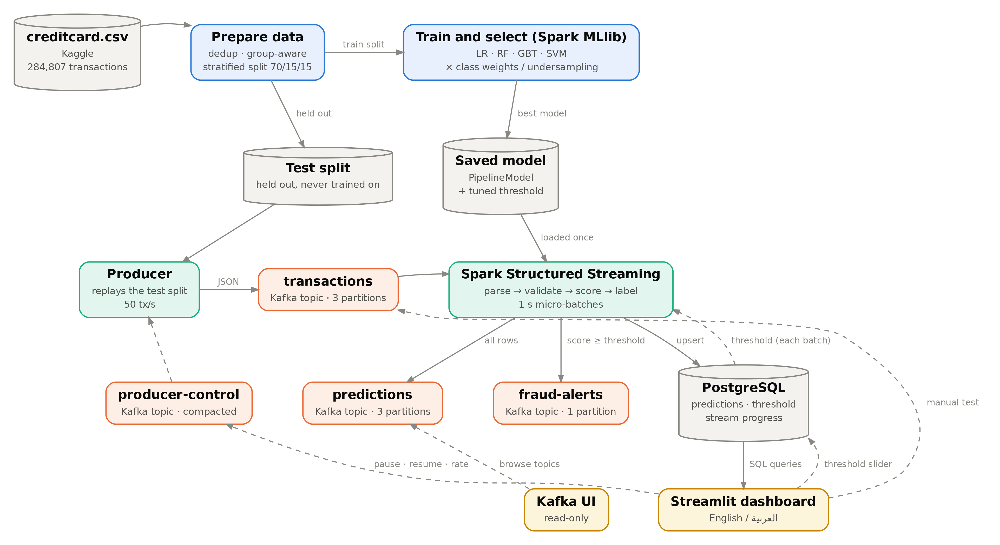
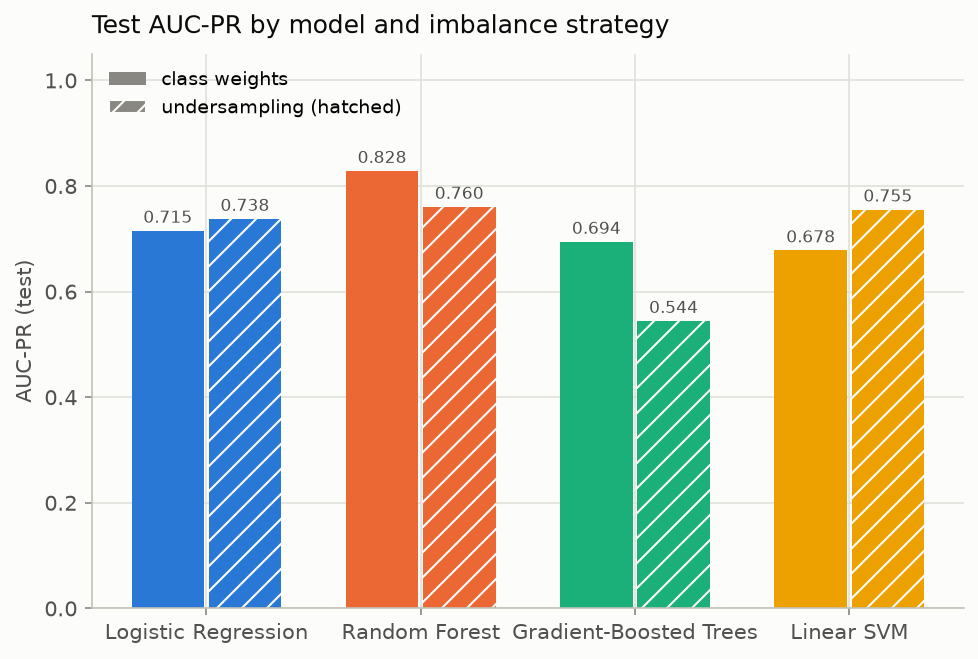
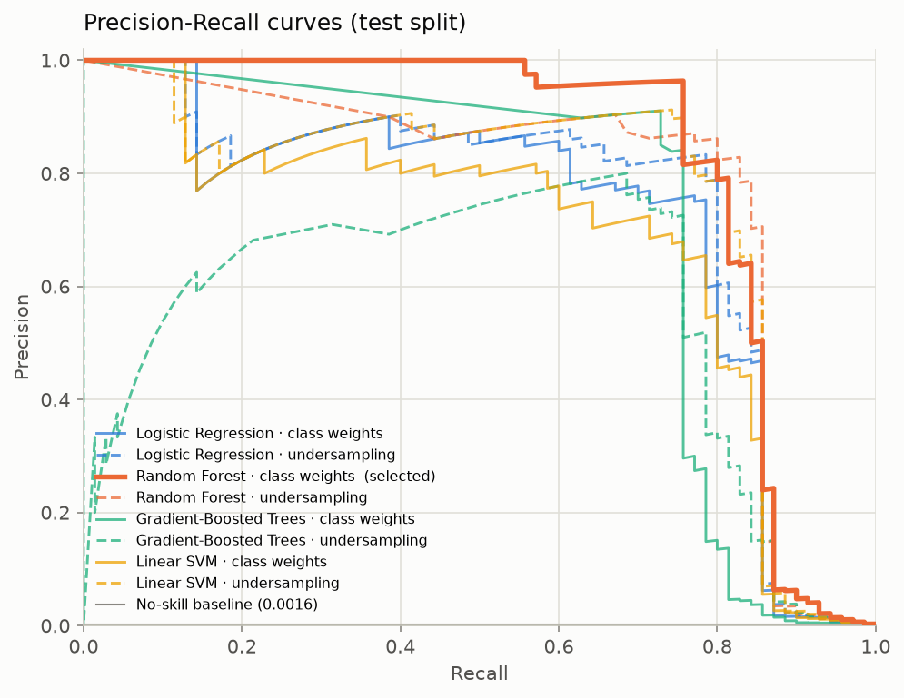

# System Overview: Real-Time Credit Card Fraud Detection

*A summary of the whole system: the problem, the theory behind each technique, how the system works, and the experimental results.*

---

## 1. Problem and goal

Card fraud has to be caught **while transactions happen**, and the data is **extremely imbalanced**: in the dataset used here only **0.17%** of transactions are fraud. A model that always answers "legitimate" would be 99.83% accurate and useless, so the project is about two things:

1. **Learning** a fraud classifier that works under extreme imbalance, and evaluating it honestly.
2. **Serving** that model in a **real-time streaming system** built on the Hadoop ecosystem (Apache Kafka + Apache Spark), with a dashboard for monitoring and interaction.

## 2. Dataset

**Kaggle, *Credit Card Fraud Detection*** (ULB Machine Learning Group): European cardholders' transactions over two days in September 2013.

| Property | Value |
|---|---|
| Transactions | 284,807, of which **492 are fraud (0.173%)** |
| Features | `V1`–`V28`: PCA components (anonymised for confidentiality); `Time`: seconds since the first transaction; `Amount` |
| Label | `Class` (1 = fraud) |
| After cleaning | 1,081 exact duplicates removed, leaving 283,726 rows and 473 frauds |

## 3. Theoretical background

### 3.1 Apache Kafka: the event log

Kafka is a distributed, **append-only log**. Producers write messages to **topics**; each topic is split into **partitions** (units of parallelism and ordering), and each message gets a sequential **offset**. Consumers read at their own pace and track offsets, so data can be **replayed**. This project uses **Kafka 4.1 in KRaft mode**: the broker manages its own metadata through a Raft quorum, so ZooKeeper is no longer needed. Two special features are used:
- **Log compaction** (`producer-control`): Kafka keeps only the latest message per key, so the topic always holds the current producer state.
- **Retention limits** (time and size): bound disk usage on the high-volume topics.

### 3.2 Spark Structured Streaming: stream processing as incremental batches

Structured Streaming treats a stream as an **unbounded table** and runs the same DataFrame operations on it **incrementally**, in **micro-batches** (here, one every second). Key concepts:
- **Checkpointing:** the processed Kafka offsets are saved durably, so after a crash the query resumes exactly where it stopped.
- **`foreachBatch`:** gives each micro-batch to ordinary batch code, so it can be written to several sinks (Kafka topics and PostgreSQL).
- **Delivery semantics:** a replayed micro-batch is written again (*at-least-once*). Making the database write **idempotent** (`INSERT … ON CONFLICT DO NOTHING`) gives *effectively-once* results in PostgreSQL.

### 3.3 Spark MLlib: pipelines

An MLlib **Pipeline** chains feature transformers and an estimator. Once fitted, it becomes a **PipelineModel** that can be saved and applied unchanged to a stream. That avoids *train/serve skew*: streaming applies exactly the transforms used in training.

### 3.4 Learning from imbalanced data

| Technique | Idea | Trade-off |
|---|---|---|
| **Class weights** | Give both classes the same total weight (n/2), so one fraud counts about 600× as much as one legitimate transaction in the loss | Keeps all data; can over-emphasise noisy frauds |
| **Random undersampling** | Keep every fraud and a random sample of legitimate rows (1:10) | Fast; throws away about 98% of legitimate examples |

**Models compared:**
- **Logistic Regression** is a linear model with probabilistic output.
- **Random Forest** is an ensemble of decorrelated decision trees (bagging plus random feature subsets) that captures non-linear interactions.
- **Gradient-Boosted Trees** add shallow trees one by one, each correcting the previous ones' errors.
- **Linear SVM** learns a maximum-margin linear separator. It outputs a margin, not a probability, so **Platt scaling** (a logistic regression fitted on the margin) converts it into one.

### 3.5 Evaluation under imbalance

- **Precision** = TP / (TP + FP): of the alerts raised, how many are real fraud. **Recall** = TP / (TP + FN): of all frauds, how many are caught. **F1** is their harmonic mean.
- **ROC-AUC** is dominated by the huge number of true negatives, so every reasonable model scores about 0.95–0.98.
- **AUC-PR**, the area under the precision–recall curve, focuses on the rare positive class and is the recommended metric for imbalanced problems. It is the **primary selection metric** here.
- **Threshold tuning:** a classifier outputs a score, and an alert fires when the score ≥ *threshold*. The threshold is chosen to **maximise F1 on the validation set**. In the dashboard it can be moved live to trade precision against recall.
- **Bootstrap confidence intervals:** the test transactions are resampled 1,000 times. With only about 70 test frauds, this shows how much of a difference between models is just sampling noise.

### 3.6 Avoiding data leakage

Leakage means the model indirectly sees test information, which inflates results. The safeguards here:
1. **Exact duplicates removed before splitting.**
2. A **group-aware split:** rows that are identical in all model inputs and differ only in `Time` (12,446 rows, the "feature twins") always land in the same split.
3. An **exact stratified 70/15/15 train/validation/test split.** Model, hyper-parameters and threshold are chosen on **validation**; **test** is used only for the final numbers.
4. **The stream replays only the test split**, and the true label travels with each event for monitoring only. It is never a model feature, and a unit test enforces this.

## 4. How the system works

**Offline (once):** the **trainer** (Spark MLlib) cleans and splits the data, trains 16 candidates (4 models × 2 imbalance strategies × 2 hyper-parameter settings), selects the best by validation AUC-PR, tunes the alert threshold, and saves the **PipelineModel**, the metrics and the report figures.

**Online (continuously):** the life of one transaction:

1. The **producer** reads the next row of the held-out test split, gives it a new ID and timestamp, and publishes it as JSON to the Kafka topic **`transactions`** (50 per second by default, looping).
2. **Spark Structured Streaming** reads new offsets every second. In one plan, built once, it **parses** the JSON, **validates** the row (malformed or non-finite values are dropped and counted, so they can't crash the query), **scores** it with the PipelineModel, and adds the processing time, latency and hour.
3. For each micro-batch, Spark reads the **current alert threshold** from PostgreSQL and labels each row: fraud if score ≥ threshold.
4. It writes **every** result to the topic **`predictions`**, **flagged** ones to **`fraud-alerts`**, and all of them to **PostgreSQL** (idempotent upsert). The checkpoint records the processed offsets.
5. The **Streamlit dashboard** queries PostgreSQL every 2 seconds and shows live KPIs, alerts, charts and live model quality.

**Feedback paths:**
- The **threshold slider** writes to PostgreSQL, and Spark uses the new value from the next micro-batch.
- **Pause / resume / rate** commands go to the compacted `producer-control` topic, and the producer applies them immediately.
- The **Test a Transaction** page sends a real transaction through the whole pipeline and shows its result.

| Dashboard page | Purpose |
|---|---|
| Live Monitor | Throughput, latency, fraud rate, live feed, fraud alerts, charts, live precision/recall |
| Model Performance | Offline comparison table with confidence intervals; PR, ROC, confusion matrix, threshold sweep |
| Test a Transaction | Send a real or edited transaction through Kafka and see its score |
| System Health | Kafka topics and offsets, Spark progress and lag, producer state, database size |
| Architecture / About | This diagram and component descriptions (English and Arabic) |

**Deployment:** everything (Kafka, Spark, PostgreSQL, producer, dashboard, Kafka UI) runs in **Docker Compose** and starts with one command. Versions are pinned, health checks are in place, all ports are bound to localhost only, and the whole stack uses about 2.6 GB of memory.

## 5. Experiments

### 5.1 Set-up

| Item | Value |
|---|---|
| Splits | train 198,610 (332 frauds) · validation 42,559 (71) · test 42,557 (70); the fraud rate is 0.165–0.167% in every split |
| Grid | LR `regParam` ∈ {0.001, 0.01}; RF `maxDepth` ∈ {8, 12} (100 trees); GBT `maxIter` ∈ {50, 100} (depth 5); SVM `regParam` ∈ {0.001, 0.01} |
| Selection | validation AUC-PR (exact, without MLlib's default binning) |
| Environment | Spark 4.1.4 in Docker, 4 CPUs, seed 42; training takes about 8 min |

### 5.2 Results (test split)

| Model | Imbalance | Test AUC-PR | 95% CI (AP) | ROC-AUC | Precision | Recall | F1 |
|---|---|---:|:---:|---:|---:|---:|---:|
| Logistic Regression | class weights | 0.715 | 0.61–0.83 | 0.966 | 0.754 | 0.743 | 0.748 |
| Logistic Regression | undersampling | 0.738 | 0.63–0.85 | 0.970 | 0.825 | 0.743 | 0.782 |
| **Random Forest ★** | **class weights** | **0.828** | **0.75–0.91** | 0.982 | **0.964** | 0.757 | **0.848** |
| Random Forest | undersampling | 0.760 | 0.65–0.87 | 0.973 | 0.900 | 0.643 | 0.750 |
| Gradient-Boosted Trees | class weights | 0.694 | 0.58–0.80 | 0.948 | 0.906 | 0.686 | 0.780 |
| Gradient-Boosted Trees | undersampling | 0.544 | 0.45–0.70 | 0.979 | 0.732 | 0.743 | 0.738 |
| Linear SVM (Platt) | class weights | 0.678 | 0.57–0.80 | 0.968 | 0.804 | 0.586 | 0.678 |
| Linear SVM (Platt) | undersampling | 0.755 | 0.65–0.86 | 0.976 | 0.897 | 0.743 | 0.813 |

**Selected model: Random Forest with class weights**, alert threshold 0.48. On the test split it catches **53 of 70 frauds** with only **2 false alarms** among 42,487 legitimate transactions.

### 5.3 Findings

1. **ROC-AUC can't rank the models** (0.948–0.982 for all eight), while **AUC-PR spreads from 0.54 to 0.83**. This confirms that AUC-PR is the right metric for this problem.
2. **The best imbalance strategy depends on the model.** Tree ensembles do best with **class weights**, because they keep all the legitimate data. The linear models gain from **undersampling**: test AUC-PR rises from 0.715 to 0.738 for LR and from 0.678 to 0.755 for the SVM.
3. **Random Forest is the strongest model under both strategies.** GBT is the least robust: with undersampling its validation AUC-PR falls to 0.57–0.59, against 0.79 with class weights.
4. **Uncertainty matters.** With 70 test frauds the 95% intervals are wide, and the top models' intervals overlap, so the ranking among them is not statistically conclusive. Reporting the intervals keeps the conclusions honest.
5. **The model behaves the same live.** Over 227,754 replayed test transactions, live precision was 0.961 and recall 0.770, matching the offline test results (0.964 and 0.757).

### 5.4 Streaming performance

Measured by the automated end-to-end test over 60 s of steady traffic:

| Metric | First version | After optimization |
|---|---:|---:|
| Throughput | 51 tx/s | **51 tx/s** |
| Micro-batch duration (steady state) | ~2.2 s | **~0.8 s** |
| Processing latency, p50 / p95 | 2.5 / 4.0 s | **0.58 / 1.2 s** |
| **End-to-end latency, p50 / p95** (event → stored) | 3.3 / 4.9 s | **1.7 / 2.6 s** |

The optimization came from **measuring** each step. Applying the model *inside* the streaming plan, rather than rebuilding it in every micro-batch, removed about 0.5 s of fixed overhead per batch. Merging Spark jobs and coalescing small batches removed most of the rest.

### 5.5 Verification

- **538 unit tests** (96.0% code coverage), including tests for leakage guards, malformed messages and the metric calculations.
- **11 end-to-end tests** on the running Docker stack, for example "a known fraud produces an alert on Kafka" and "a threshold change reaches Spark".
- An **independent code review** found 14 issues (2 High). 12 were fixed, 1 was partly fixed, and 1 turned out not to apply when measured.

## 6. Limitations and future work

| Limitation | Possible improvement |
|---|---|
| Model selection uses a single validation split with ~71 frauds | Stratified k-fold cross-validation, or repeated splits |
| Scores are calibrated only for the SVM, so other models' scores are not true probabilities | Platt or isotonic calibration on a separate calibration set |
| Random, not time-ordered, split; the PCA features are anonymised | Time-based validation; richer behavioural features (velocity, merchant) on real data |
| Single Kafka broker and Spark `local[*]` | More partitions, a Spark cluster and replicated Kafka. The code doesn't change. |
| Fixed model | Drift monitoring, scheduled retraining, A/B comparison of models |

## 7. References

1. A. Dal Pozzolo, O. Caelen, R. A. Johnson, G. Bontempi. *Calibrating Probability with Undersampling for Unbalanced Classification.* IEEE Symposium Series on Computational Intelligence (CIDM), 2015. *(Source of the dataset.)*
2. T. Saito, M. Rehmsmeier. *The Precision-Recall Plot Is More Informative than the ROC Plot When Evaluating Binary Classifiers on Imbalanced Datasets.* PLoS ONE 10(3): e0118432, 2015.
3. J. Platt. *Probabilistic Outputs for Support Vector Machines and Comparisons to Regularized Likelihood Methods.* Advances in Large Margin Classifiers, MIT Press, 1999.
4. L. Breiman. *Random Forests.* Machine Learning 45(1), 2001.
5. J. H. Friedman. *Greedy Function Approximation: A Gradient Boosting Machine.* Annals of Statistics 29(5), 2001.
6. J. Kreps, N. Narkhede, J. Rao. *Kafka: a Distributed Messaging System for Log Processing.* NetDB Workshop, 2011.
7. M. Armbrust et al. *Structured Streaming: A Declarative API for Real-Time Applications in Apache Spark.* SIGMOD, 2018.
8. M. Zaharia et al. *Apache Spark: A Unified Engine for Big Data Processing.* Communications of the ACM 59(11), 2016.

---

*Details: [PLAN.md](../PLAN.md) (design) · [RESULTS.md](RESULTS.md) (all training results) · [E2E_REPORT.md](E2E_REPORT.md) (latest performance run) · [REVIEW.md](../REVIEW.md) (code review) · [README.md](../README.md) (how to run).*
